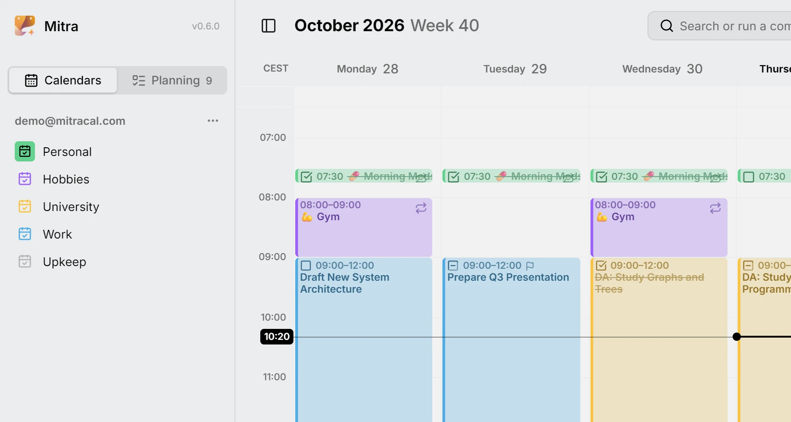
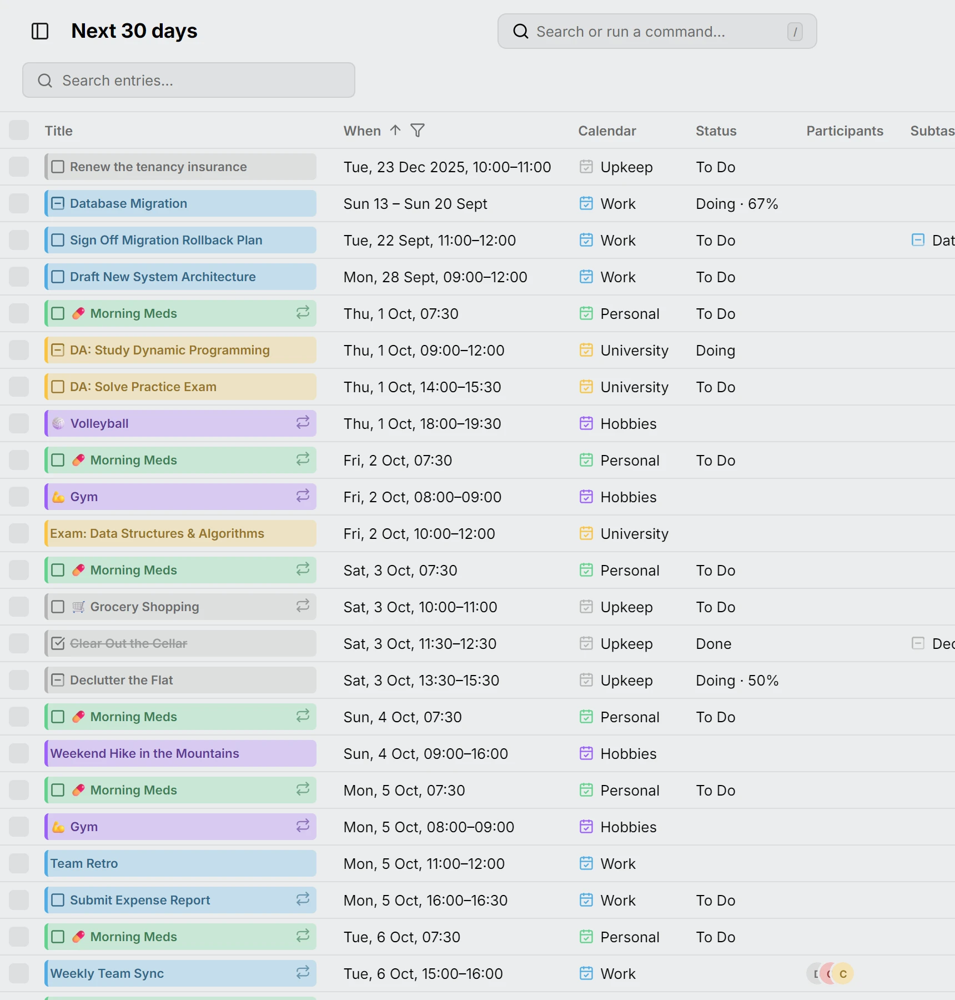
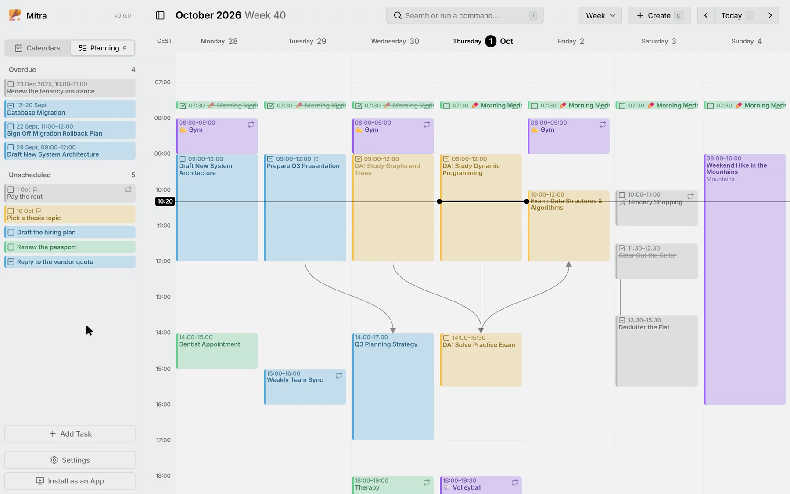
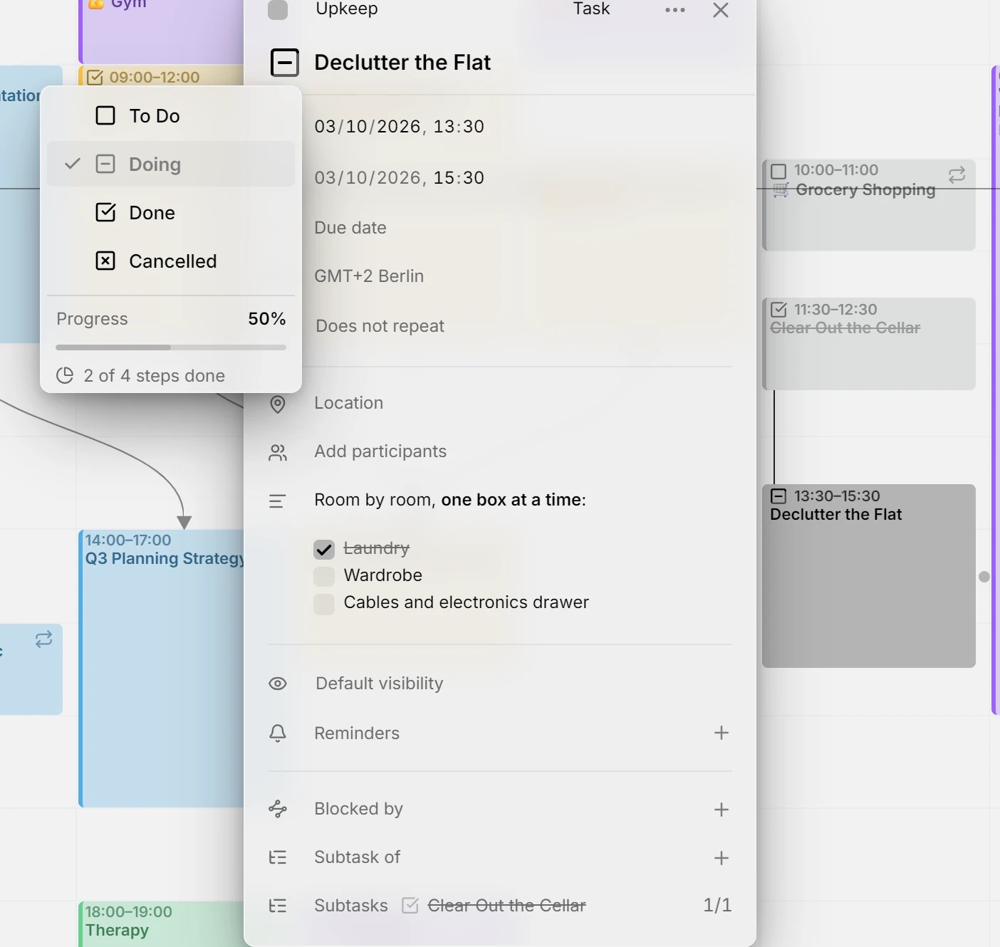
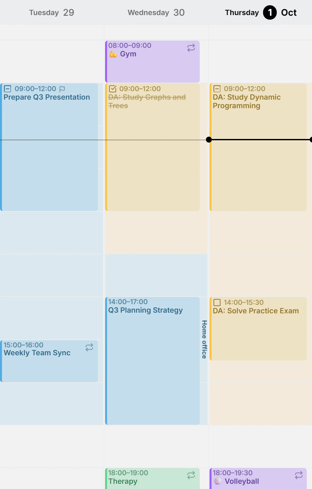
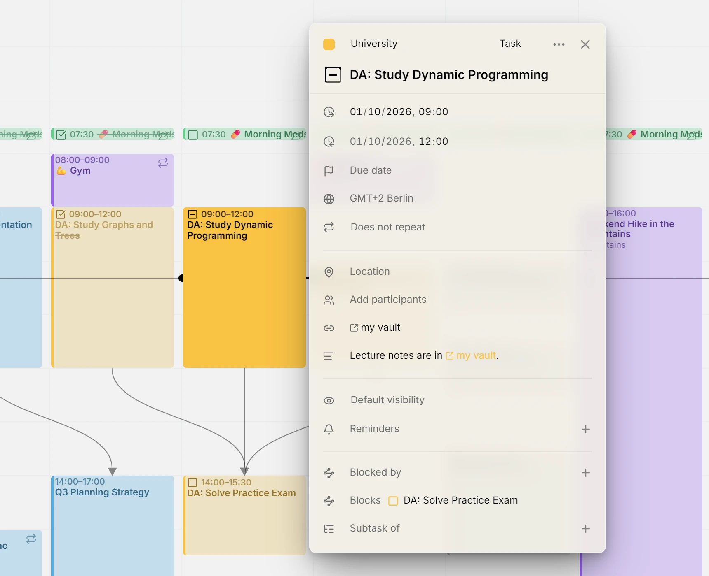
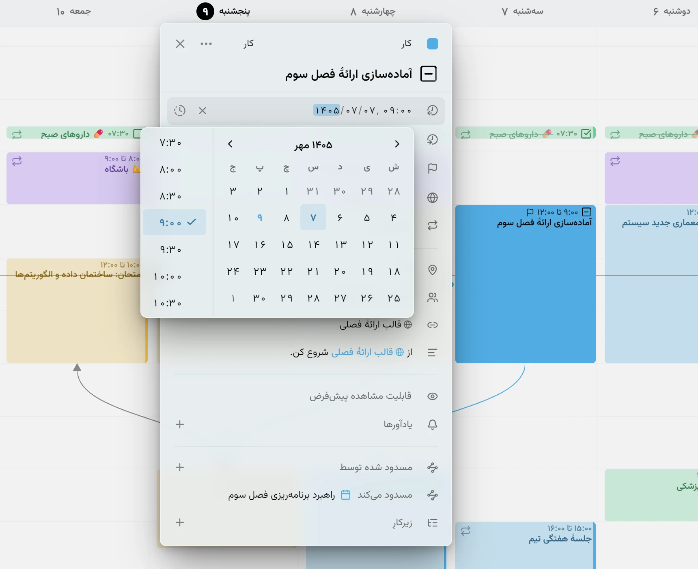

В этом выпуске у Mitra появились собственные календари, записи можно увидеть в виде таблицы, а у задач появились недостающие ограничения: срок, оценка времени и часы, которые вы оставляете свободными. Кроме того, Mitra теперь говорит на персидском, вместе с персидским календарём.

## Календари Mitra
Календарь может храниться в самом Mitra: без стороннего аккаунта и без входа куда-либо. Установите Mitra, добавьте календарь и начинайте планировать. Он появится на всех ваших устройствах, а его записи можно перенести в подключённый аккаунт, когда вы его подключите.

<picture>
	<source media="(prefers-color-scheme: dark)" srcset="calendars-detail-dark.webp">
	
</picture>

Документация: [Календари Mitra](../../docs/integrations/mitra.md)

## Вид таблицы
Каждая запись в отдельной строке. Выберите, за какие дни показывать записи, от прошлого месяца до всех сразу, ищите по названиям, местам и описаниям, сортируйте сразу по нескольким столбцам и фильтруйте по статусу, календарю, типу или повтору. Выделите строки, чтобы изменить несколько записей разом. Название показано той же плашкой, что и в календаре, поэтому запись открывается прямо в таблице.

<picture>
	<source media="(prefers-color-scheme: dark)" srcset="table-detail-dark.webp">
	
</picture>

Документация: [Вид таблицы](../../docs/views/table.md)

## Сроки и оценка времени
У задачи может быть срок и оценка времени ещё до того, как она запланирована. Незапланированные задачи выстраиваются на вкладке «Планирование» по ближайшему сроку, а когда вы перетаскиваете одну из них на неделю, оценка времени становится её длительностью. Задачи, которые пропустили свой день, собираются над ними в разделе «Просроченные».

<picture>
	<source media="(prefers-color-scheme: dark)" srcset="plan-task-dark.webp">
	
</picture>

Документация: [Планирование](../../docs/planning.md)

## Чек-листы в описаниях
В описании задачи может быть чек-лист, написанный в Markdown, и флажки в нём настоящие: отметьте один в редакторе, и Mitra запишет это обратно в текст, так что это увидит и любое другое приложение, работающее с этим календарём. Флажки и подзадачи считаются вместе, каждый как один шаг. У задачи с тремя флажками и одной подзадачей четыре шага, и если отметить один флажок и выполнить подзадачу, меню статуса покажет, что выполнено 2 шага из 4, а кольцо на плашке задачи заполнится наполовину.

<picture>
	<source media="(prefers-color-scheme: dark)" srcset="checklist-dark.webp">
	
</picture>

Документация: [Подзадачи](../../docs/subtasks.md)

## Доступность
Отметьте в любом календаре часы, когда вы работаете, тренируетесь или хотите оставаться свободными. Они затеняют вид недели, и свободные часы сразу бросаются в глаза. Занятые часы видны как занятые людям, с которыми вы делите календарь, а свободные остаются только вашими.

<picture>
	<source media="(prefers-color-scheme: dark)" srcset="availability-detail-dark.webp">
	
</picture>

Документация: [Доступность](../../docs/availability.md)

## Все ссылки в одной строке
Все ссылки из описания или места записи собираются в строке «Ссылки» редактора и подписаны по тому, куда ведут: страница по названию сайта, встреча по сервису, заметка по приложению. Если место задано ссылкой, оно и показывается как ссылка.

<picture>
	<source media="(prefers-color-scheme: dark)" srcset="links-detail-dark.webp">
	
</picture>

Документация: [Ссылки](../../docs/links.md)

## Персидский календарь
Mitra говорит на персидском, а вместе с языком приходит и его календарь: персидские месяцы и недели в заголовках и окнах выбора даты, а даты вводятся так, как их пишут по-персидски. Ваши записи остаются на своих местах. Меняется только то, как они читаются.

<picture>
	<source media="(prefers-color-scheme: dark)" srcset="persian-calendar-detail-dark.webp">
	
</picture>

Документация: [Настройки](../../docs/settings.md)

## Авторы
- [@a11delavar](https://github.com/a11delavar)
