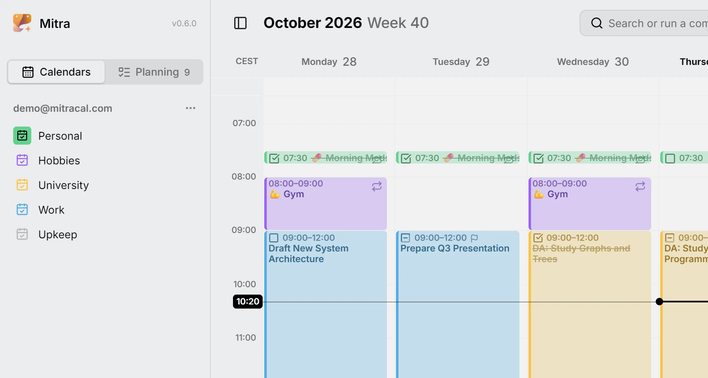
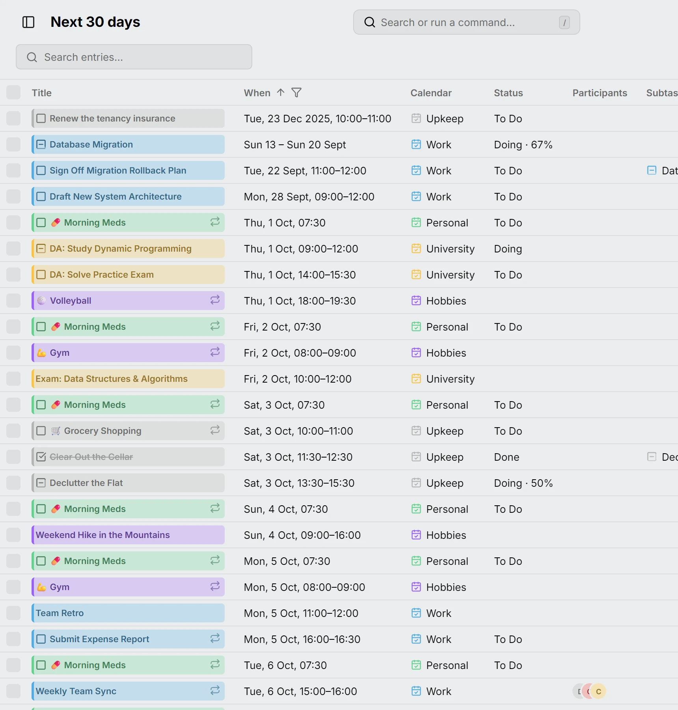
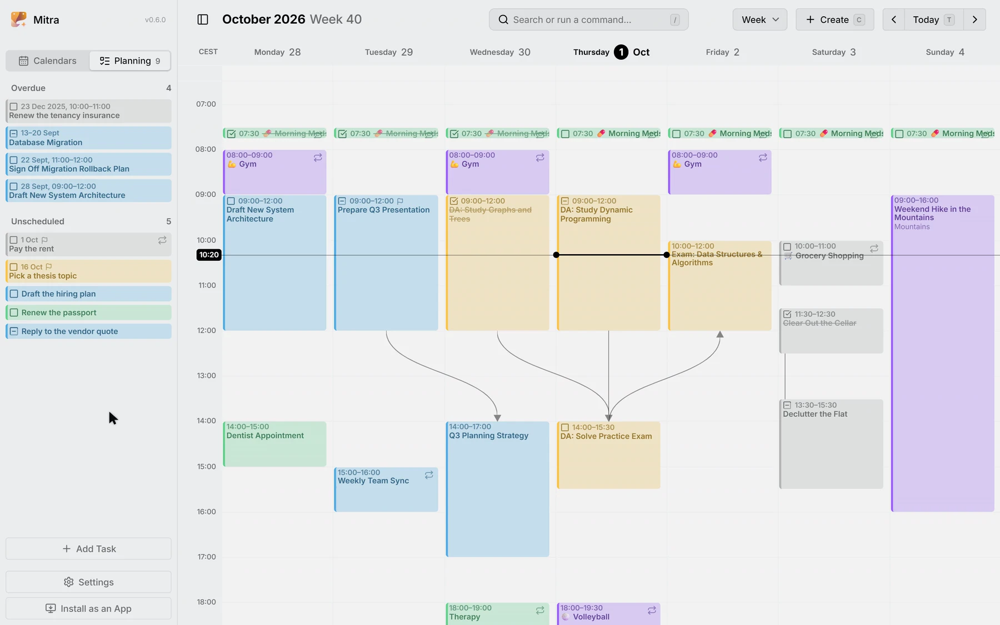
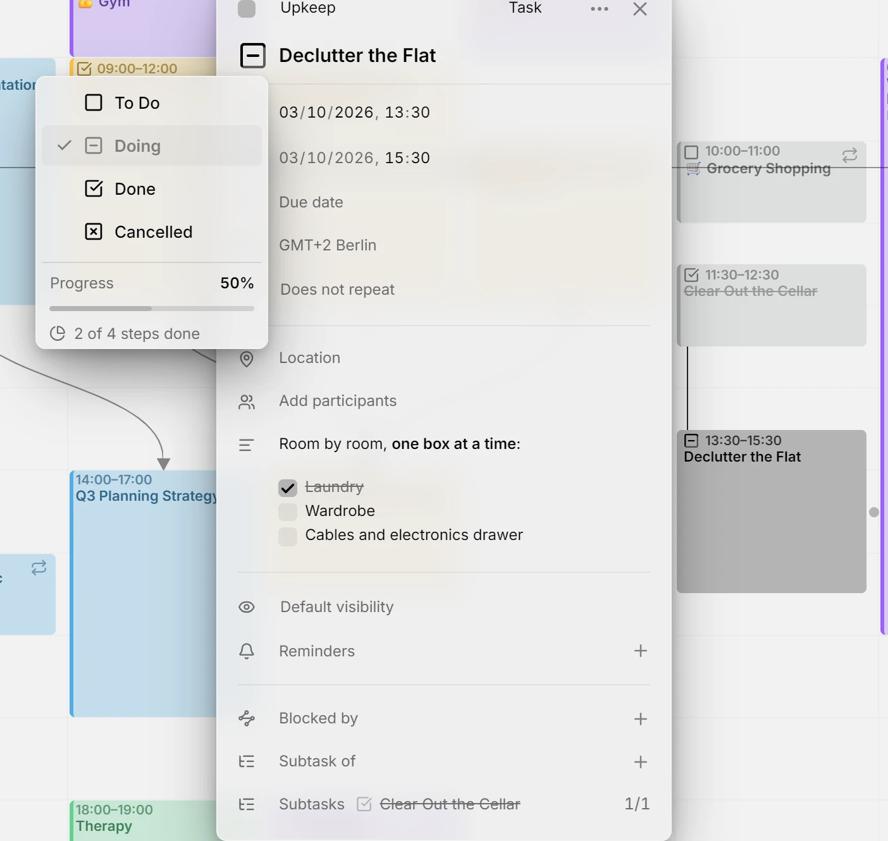
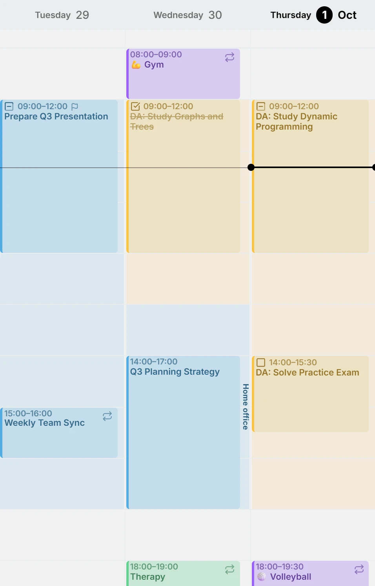
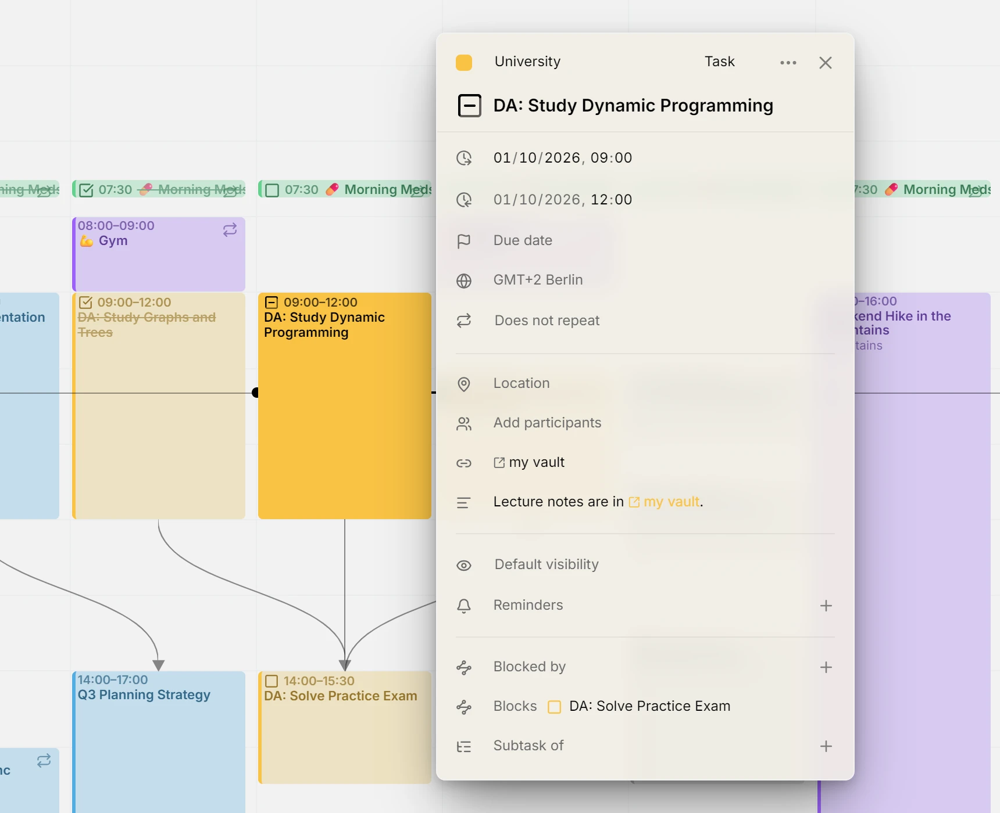
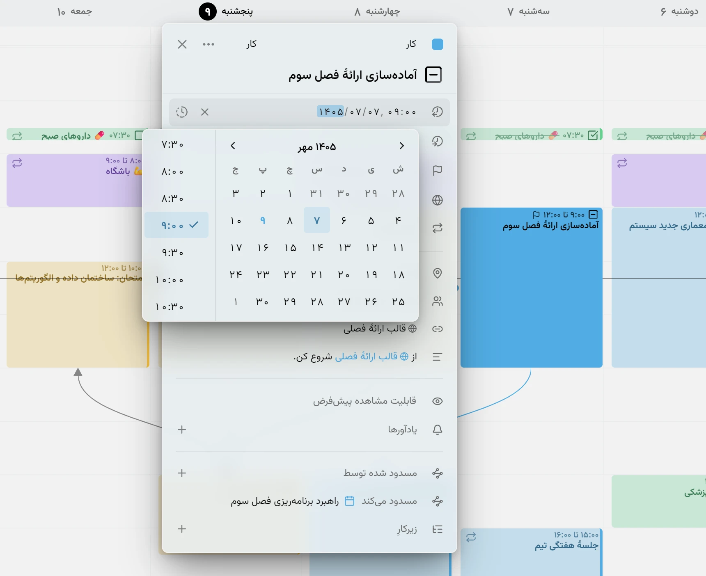

Phiên bản này cho Mitra những cuốn lịch của riêng nó, bày các mục của bạn thành một bảng, và trao cho công việc những ràng buộc còn thiếu: hạn chót, thời gian ước tính, và những giờ bạn để trống. Mitra cũng nói được tiếng Ba Tư, kể cả lịch Ba Tư.

## Lịch Mitra
Một cuốn lịch có thể nằm ngay trong Mitra, không có tài khoản nào phía sau và không cần đăng nhập vào đâu. Cài đặt Mitra, thêm một lịch, và bắt đầu lên kế hoạch. Nó hiện trên mọi thiết bị bạn dùng, và các mục của nó có thể chuyển sang một tài khoản đã kết nối bất cứ khi nào bạn kết nối một tài khoản.

<picture>
	<source media="(prefers-color-scheme: dark)" srcset="calendars-detail-dark.webp">
	
</picture>

Tài liệu: [Lịch Mitra](../../docs/integrations/mitra.md)

## Chế độ xem bảng
Mỗi mục là một hàng. Chọn những ngày cần liệt kê, từ tháng vừa qua đến mọi thứ bạn có, tìm kiếm trong tiêu đề, địa điểm và mô tả, sắp xếp theo nhiều cột cùng lúc, và lọc theo trạng thái, lịch, loại hoặc việc lặp lại. Chọn các hàng để đổi nhiều mục cùng lúc. Tiêu đề chính là chiếc thẻ mà lịch vẽ, nên một mục mở ngay tại đó.

<picture>
	<source media="(prefers-color-scheme: dark)" srcset="table-detail-dark.webp">
	
</picture>

Tài liệu: [Chế độ xem bảng](../../docs/views/table.md)

## Hạn chót và thời gian ước tính
Một công việc có thể mang hạn chót và thời gian ước tính trước khi nó có giờ. Các công việc chưa lên lịch xếp hàng trong Kế hoạch theo cái nào đến hạn trước, và khi bạn kéo một việc vào tuần, thời gian ước tính trở thành độ dài của nó. Các công việc đã trễ qua ngày của chúng tụ lại trong mục Quá hạn phía trên.

<picture>
	<source media="(prefers-color-scheme: dark)" srcset="plan-task-dark.webp">
	
</picture>

Tài liệu: [Kế hoạch](../../docs/planning.md)

## Danh sách kiểm trong mô tả
Mô tả của một công việc có thể chứa một danh sách kiểm viết bằng Markdown, và các ô là thật: đánh dấu một ô trong trình chỉnh sửa và Mitra ghi lại vào văn bản, nên mọi ứng dụng khác trên lịch đó cũng thấy. Các ô và công việc con được đếm cùng nhau, mỗi cái là một bước: một công việc có ba ô và một công việc con có bốn bước, và khi một ô được đánh dấu và công việc con đã xong, menu trạng thái của nó ghi 2 trên 4 bước đã xong, còn vòng tròn trên thẻ của nó đầy một nửa.

<picture>
	<source media="(prefers-color-scheme: dark)" srcset="checklist-dark.webp">
	
</picture>

Tài liệu: [Công việc con](../../docs/subtasks.md)

## Thời gian khả dụng
Vẽ những giờ bạn làm việc, tập luyện hoặc để trống, trong bất kỳ lịch nào. Chúng tô bóng chế độ xem tuần để các giờ trống nổi bật. Những giờ bận hiện là bận với những người bạn dùng chung lịch, còn những giờ rảnh vẫn là của riêng bạn.

<picture>
	<source media="(prefers-color-scheme: dark)" srcset="availability-detail-dark.webp">
	
</picture>

Tài liệu: [Thời gian khả dụng](../../docs/availability.md)

## Liên kết trong một hàng
Mọi liên kết trong mô tả hoặc địa điểm của một mục được gom vào một hàng Liên kết của trình chỉnh sửa, đặt tên theo nơi nó dẫn đến: một trang theo trang web của nó, một cuộc họp theo dịch vụ của nó, một ghi chú theo ứng dụng của nó. Một địa điểm là liên kết sẽ hiện như liên kết đó.

<picture>
	<source media="(prefers-color-scheme: dark)" srcset="links-detail-dark.webp">
	
</picture>

Tài liệu: [Liên kết](../../docs/links.md)

## Lịch Ba Tư
Mitra nói được tiếng Ba Tư, và cùng với ngôn ngữ là lịch của nó: các tháng và tuần Ba Tư trong phần đầu trang và các bộ chọn, và ngày được gõ theo cách người Ba Tư viết. Các mục của bạn vẫn ở nguyên chỗ cũ. Chỉ cách chúng được đọc là thay đổi.

<picture>
	<source media="(prefers-color-scheme: dark)" srcset="persian-calendar-detail-dark.webp">
	
</picture>

Tài liệu: [Cài đặt](../../docs/settings.md)

## Người đóng góp
- [@a11delavar](https://github.com/a11delavar)
