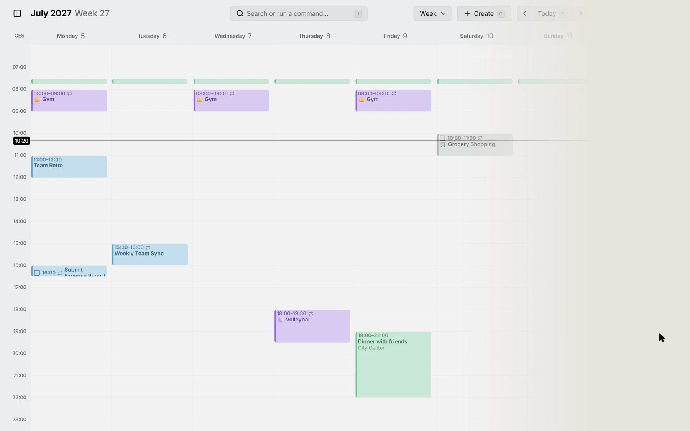
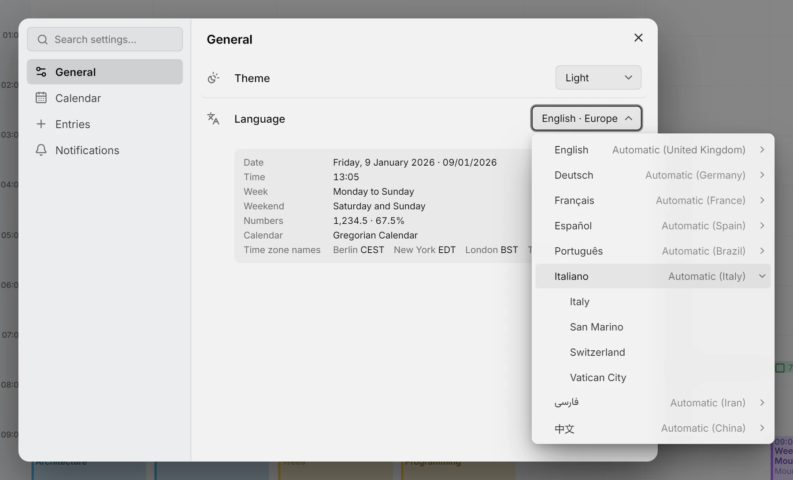
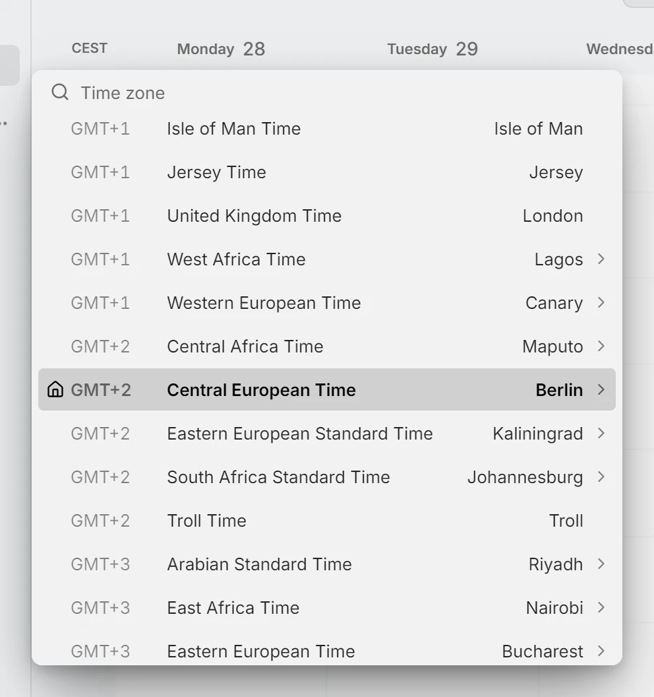
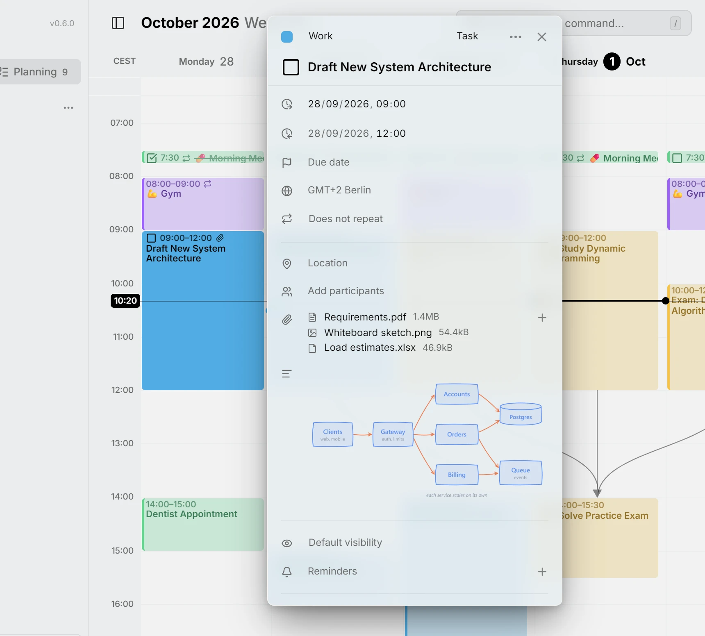
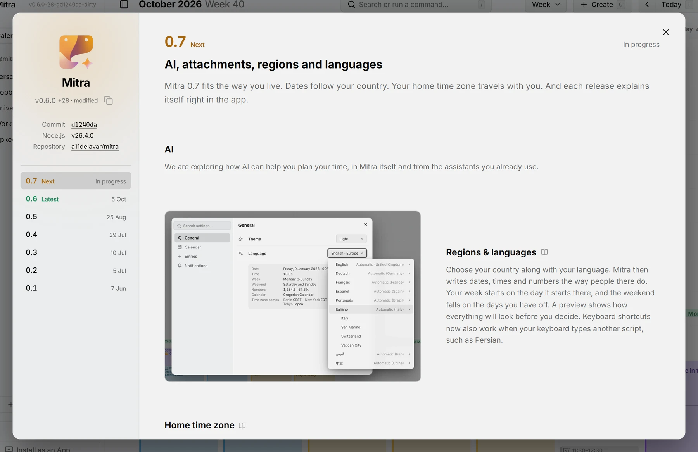
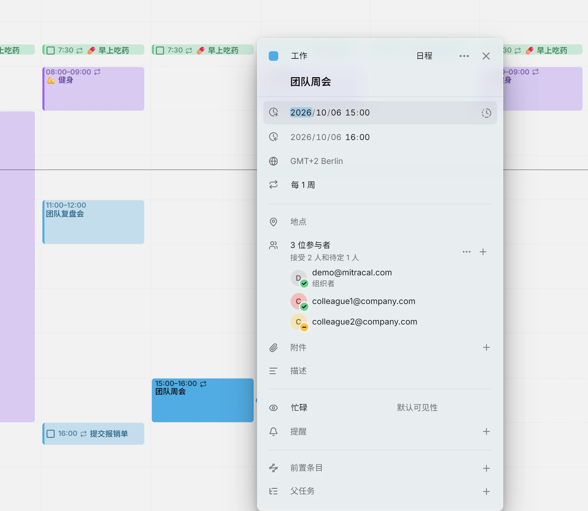

Mitra 0.7は、すでに使っているAIアシスタントと連携し、カレンダーの中で直接あなたの時間を計画できます。項目にファイルを添付できるようになり、Mitraはあなたの地域の書き方で日付を書き、旅行中もホームのタイムゾーンがそばにいます。Mitraは中国語にも対応し、アプリを離れずに変更内容を読めます。ドラッグ、ズーム、読み込みも速くなり、小さな改善と修正もたくさんあります。

## AIコネクタ
ClaudeやCursorのようなAIアシスタントがカレンダーを操作できるようになりました。設定 → AIにあるアドレスで接続して、自分の手でやっていたことを任せましょう。週を見る、項目を探す、旅行を計画する、会議を移動する、など。AIが書き込んだ内容はほかの変更と同じようにカレンダーに届き、そこから同期されます。サインインするサーバーでは、アシスタントごとに専用のアクセストークンが発行され、読み取り専用に制限したり、いつでも取り消したりできます。

<picture>
	<source media="(prefers-color-scheme: dark)" srcset="connectors-dark.webp">
	
</picture>

エッフェル塔の写真：David McSpadden、Wikimedia Commons、CC BY 2.0。

ドキュメント：[AIコネクタ](../../docs/ai-connectors.md)

## 地域と言語
言語と一緒に国も選べます。Mitraはその地域の人と同じように日付・時刻・数を書きます。週はその地域で始まる曜日に始まり、週末は休みの日に来ます。決める前に、プレビューですべての見え方を確認できます。ペルシャ語のような別の文字を入力するキーボードでも、キーボードショートカットが使えるようになりました。

<picture>
	<source media="(prefers-color-scheme: dark)" srcset="locales-dark.webp">
	
</picture>

ドキュメント：[設定](../../docs/settings.md)

## ホームのタイムゾーン
Mitraはホームのタイムゾーンを覚え、アカウントに保存します。旅行中はカレンダーがデバイスに追従し、ホームは隣の列に残ります。タイムゾーンのリストはそのままなので、帰ってくるとまた1列に戻ります。追加したタイムゾーンと付けた名前は、どのデバイスでも同じです。各列には、そのタイムゾーンで実際に使われている短い名前が見出しに付きます。

タイムゾーンピッカーも新しくなりました。名前も時計も同じタイムゾーンは1行にまとめられ、自分の国のタイムゾーンが先に来ます。家のマークがホーム、ピンのマークが旅行中にいるタイムゾーンです。

<picture>
	<source media="(prefers-color-scheme: dark)" srcset="time-zones-dark.webp">
	
</picture>

> [!NOTE]
> 今いるタイムゾーンに自分で名前を付けていた場合は、もう一度付け直してください。これまでその名前は設定したデバイスにだけ残っていました。これからは、名前がすべてのデバイスに付いてきます。

ドキュメント：[タイムゾーン](../../docs/time-zones.md)

## 添付ファイル
項目にファイルを添付できるようになりました。チケット、アジェンダ、ホワイトボードの写真など。項目のエディターにあるクリップで追加するか、開いている項目にドラッグします。ファイルをクリックすると開きます。説明にもファイルを追加でき、画像は画像として、それ以外のファイルはリンクとして表示されます。あとでファイルを削除すると、説明からも削除されます。

添付ファイルはカレンダーと同期します。CalDAVカレンダーでは、同じカレンダーを使うほかのアプリがあなたの添付ファイルを見られ、Mitraも相手が添付したファイルを表示します。Googleカレンダーでは、予定に添付されたGoogle Driveのファイルを表示しますが、GoogleがDriveのファイルしか保持しないため、追加や削除はできません。Notionページ内の画像も、タスクの説明に表示されるようになりました。

<picture>
	<source media="(prefers-color-scheme: dark)" srcset="attachments-dark.webp">
	
</picture>

> [!NOTE]
> 添付したファイルはMitraのデータフォルダーに保存されるので、そのフォルダーをバックアップすればファイルもバックアップされます。1ファイルのサイズは`MITRA_FILE_MAX_SIZE`、一人あたりの合計容量は`MITRA_FILE_QUOTA`で制限できます。

ドキュメント：[添付ファイル](../../docs/attachments.md)

## アプリ内のリリースノート
Mitraを離れずに変更内容を確認できるようになりました。バージョン情報ダイアログに、ウェブサイトと同じ形で各リリースが表示されます。使っているバージョンのノートと画像、そしてそのあとに出た修正も一緒です。すべてのコミットも、必要になるまで折りたたまれた状態で一覧されています。

<picture>
	<source media="(prefers-color-scheme: dark)" srcset="about-dark.webp">
	
</picture>

## 中国語
Mitraは中国語（簡体字）を話せるようになりました。アプリ、サンプルカレンダー、ドキュメント、ウェブサイトがすべて翻訳され、中国語のテキストには専用に作られた書体が使われます。

<picture>
	<source media="(prefers-color-scheme: dark)" srcset="chinese-detail-dark.webp">
	
</picture>

ドキュメント：[設定](../../docs/settings.md)

## コントリビューター
- [@a11delavar](https://github.com/a11delavar)
- [@d8monx](https://github.com/d8monx)
