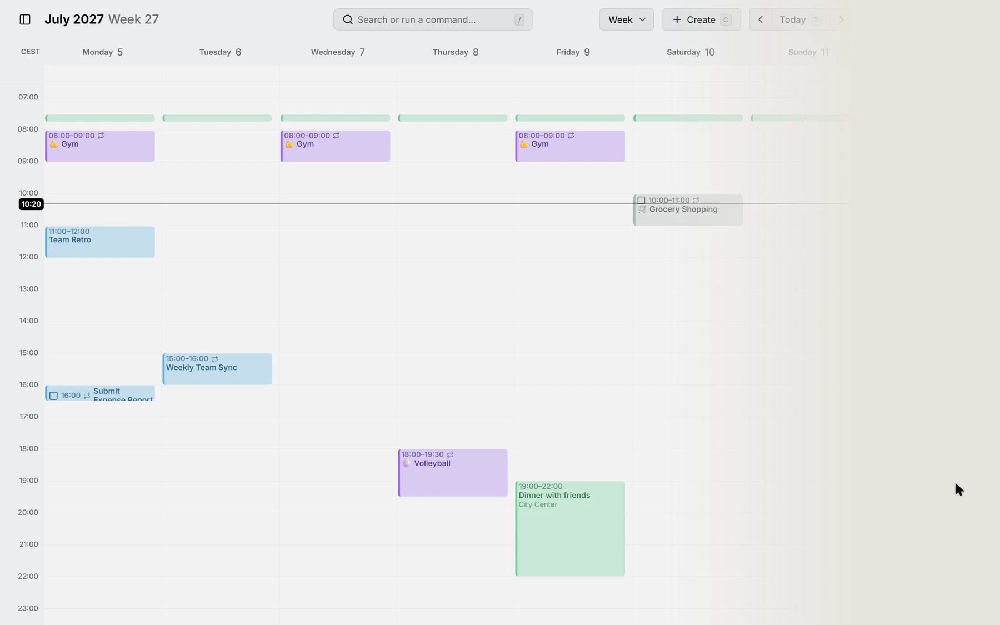
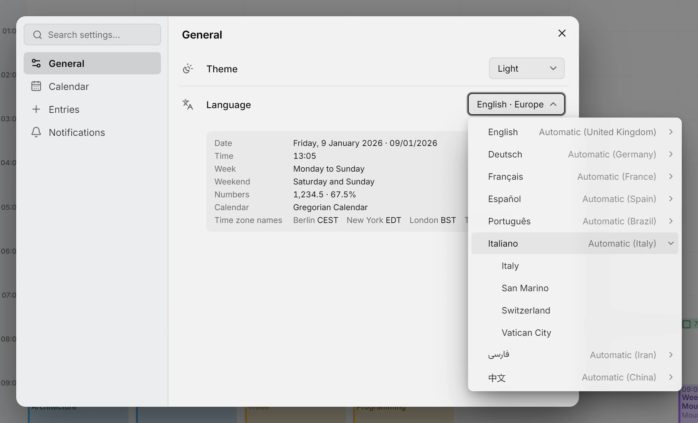
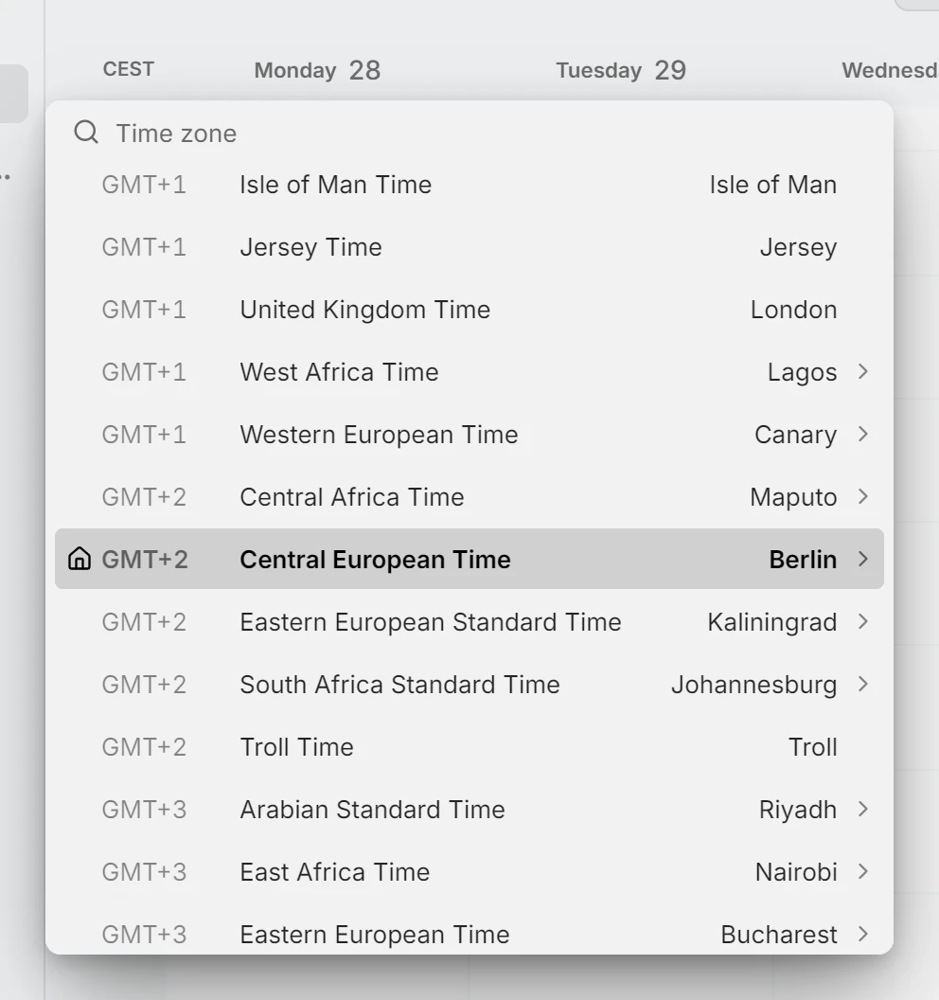
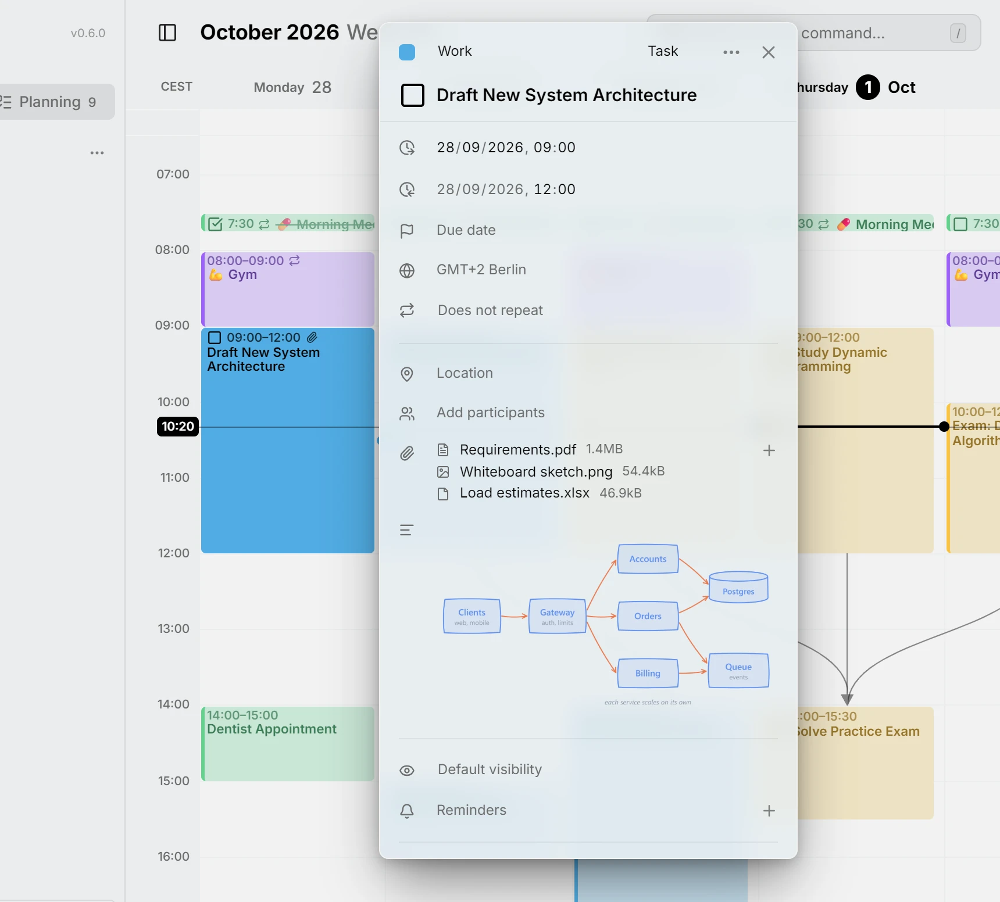
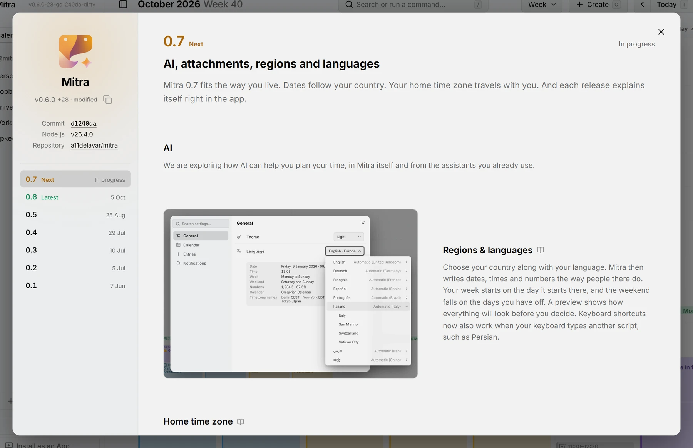
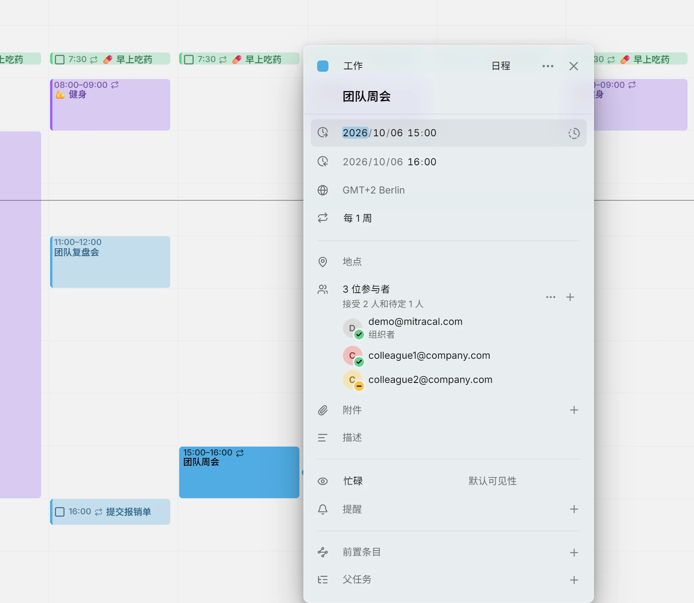

Mitra 0.7은 이미 쓰고 있는 AI 어시스턴트와 함께 작동하므로, 어시스턴트가 캘린더 안에서 바로 시간을 계획할 수 있습니다. 이제 항목에 파일을 첨부할 수 있고, Mitra는 지역의 방식대로 날짜를 표기하며, 여행할 때도 기준 시간대가 함께합니다. Mitra를 이제 중국어로 쓸 수 있고, 앱을 떠나지 않고도 변경 사항을 읽을 수 있습니다. 끌기, 확대/축소, 로딩도 더 빨라졌으며, 그 밖에도 작은 개선과 수정이 많이 있습니다.

## AI 커넥터
Claude, Cursor 같은 AI 어시스턴트가 이제 캘린더를 다룰 수 있습니다. 설정 → AI에 있는 주소로 어시스턴트를 연결하고, 평소 직접 하던 일을 요청하세요. 한 주를 살펴보거나, 항목을 찾거나, 여행을 계획하거나, 회의를 옮길 수 있습니다. 어시스턴트가 쓴 내용은 다른 변경과 마찬가지로 캘린더에 들어가고, 거기서 동기화됩니다. 사람들이 로그인하는 서버에서는 어시스턴트마다 자체 액세스 토큰을 받으며, 읽기 전용으로 제한하거나 언제든 취소할 수 있습니다.

<picture>
	<source media="(prefers-color-scheme: dark)" srcset="connectors-dark.webp">
	
</picture>

에펠탑 사진: David McSpadden, Wikimedia Commons, CC BY 2.0.

문서: [AI 커넥터](../../docs/ai-connectors.md)

## 지역과 언어
언어와 함께 국가를 고르세요. 그러면 Mitra가 그곳 사람들이 쓰는 방식대로 날짜, 시간, 숫자를 표기합니다. 한 주는 그곳에서 한 주가 시작하는 요일에 시작하고, 주말은 쉬는 날에 맞춰집니다. 결정하기 전에 미리 보기로 모든 것이 어떻게 보일지 확인할 수 있습니다. 페르시아 문자처럼 키보드가 다른 문자를 입력할 때도 이제 키보드 단축키가 작동합니다.

<picture>
	<source media="(prefers-color-scheme: dark)" srcset="locales-dark.webp">
	
</picture>

문서: [설정](../../docs/settings.md)

## 기준 시간대
이제 Mitra가 기준 시간대를 알고 계정에 보관합니다. 여행할 때 캘린더는 기기를 따라가고, 기준 시간대는 그 옆 열에 남아 있습니다. 시간대 목록은 그대로이므로, 돌아오면 다시 한 열만 보입니다. 추가한 시간대와 붙인 이름은 모든 기기에서 같습니다. 각 열의 머리글에는 사람들이 그 시간대에 실제로 쓰는 짧은 이름이 붙습니다.

시간대 선택기도 새로 디자인되었습니다. 이름과 시각이 같은 시간대는 한 행으로 묶이고, 내 국가의 시간대가 먼저 나옵니다. 집 표시는 기준 시간대를, 핀 표시는 여행 중 지금 있는 시간대를 나타냅니다.

<picture>
	<source media="(prefers-color-scheme: dark)" srcset="time-zones-dark.webp">
	
</picture>

> [!NOTE]
> 지금 있는 시간대에 직접 이름을 붙였다면, 그 이름을 한 번 더 붙여 주세요. 지금까지는 이런 이름이 설정한 기기에만 남았습니다. 이제부터는 이름이 모든 기기에 따라갑니다.

문서: [시간대](../../docs/time-zones.md)

## 첨부 파일
이제 항목에 티켓, 안건, 화이트보드 사진 같은 파일을 첨부할 수 있습니다. 항목 편집기의 클립으로 추가하거나, 열린 항목 위로 파일을 끌어다 놓으세요. 파일을 클릭하면 열립니다. 설명에 파일을 넣을 수도 있는데, 이미지는 그림으로, 그 밖의 파일은 링크로 표시됩니다. 나중에 파일을 제거하면 Mitra가 설명에서도 제거합니다.

첨부 파일은 캘린더와 함께 동기화됩니다. CalDAV 캘린더에서는 같은 캘린더를 쓰는 다른 앱에서 내가 첨부한 파일을 볼 수 있고, Mitra도 그 앱들이 첨부한 파일을 보여 줍니다. Google 캘린더에서는 Mitra가 일정에 첨부된 Google Drive 파일을 보여 주지만, Google은 Drive 파일만 보관하므로 추가하거나 제거할 수는 없습니다. 이제 Notion 페이지의 이미지도 작업 설명에 표시됩니다.

<picture>
	<source media="(prefers-color-scheme: dark)" srcset="attachments-dark.webp">
	
</picture>

> [!NOTE]
> Mitra는 첨부한 파일을 데이터 폴더에 보관하므로, 그 폴더를 백업하면 파일도 함께 백업됩니다. `MITRA_FILE_MAX_SIZE`로 파일 하나의 크기를, `MITRA_FILE_QUOTA`로 한 사람이 보관할 수 있는 총량을 제한할 수 있습니다.

문서: [첨부 파일](../../docs/attachments.md)

## 앱 안의 릴리스 노트
이제 Mitra를 떠나지 않고도 변경 사항을 볼 수 있습니다. 정보 대화 상자는 웹사이트와 같은 방식으로 각 릴리스를 보여 줍니다. 실행 중인 버전의 노트와 그림, 그 뒤에 나온 수정 사항이 함께 나옵니다. 모든 커밋도 나열되며, 필요할 때까지 접혀 있습니다.

<picture>
	<source media="(prefers-color-scheme: dark)" srcset="about-dark.webp">
	
</picture>

## 중국어
이제 Mitra가 간체자로 쓰인 중국어를 지원합니다. 앱, 샘플 캘린더, 문서, 웹사이트가 모두 번역되었고, 중국어 텍스트는 중국어용으로 만든 서체로 표시됩니다.

<picture>
	<source media="(prefers-color-scheme: dark)" srcset="chinese-detail-dark.webp">
	
</picture>

문서: [설정](../../docs/settings.md)

## 기여자
- [@a11delavar](https://github.com/a11delavar)
- [@d8monx](https://github.com/d8monx)
