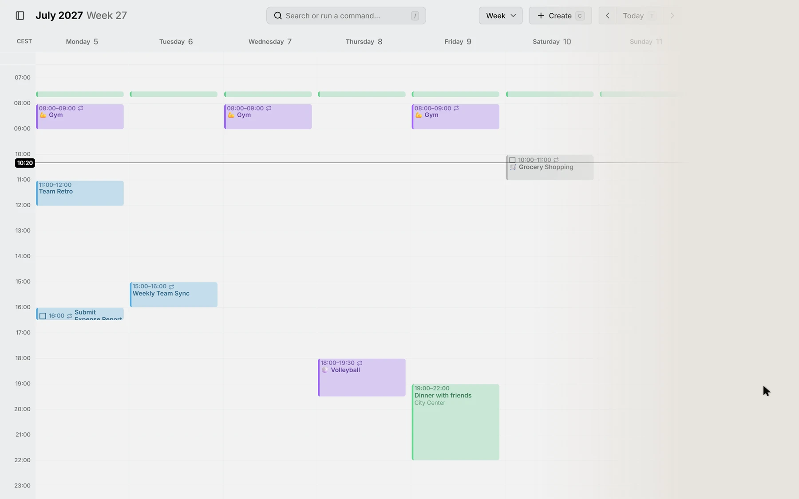
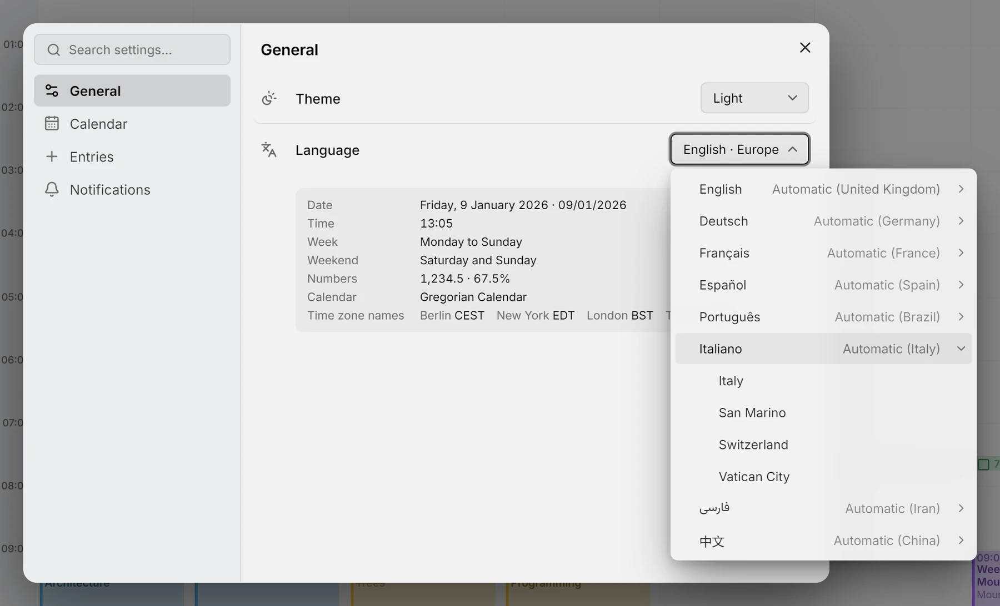
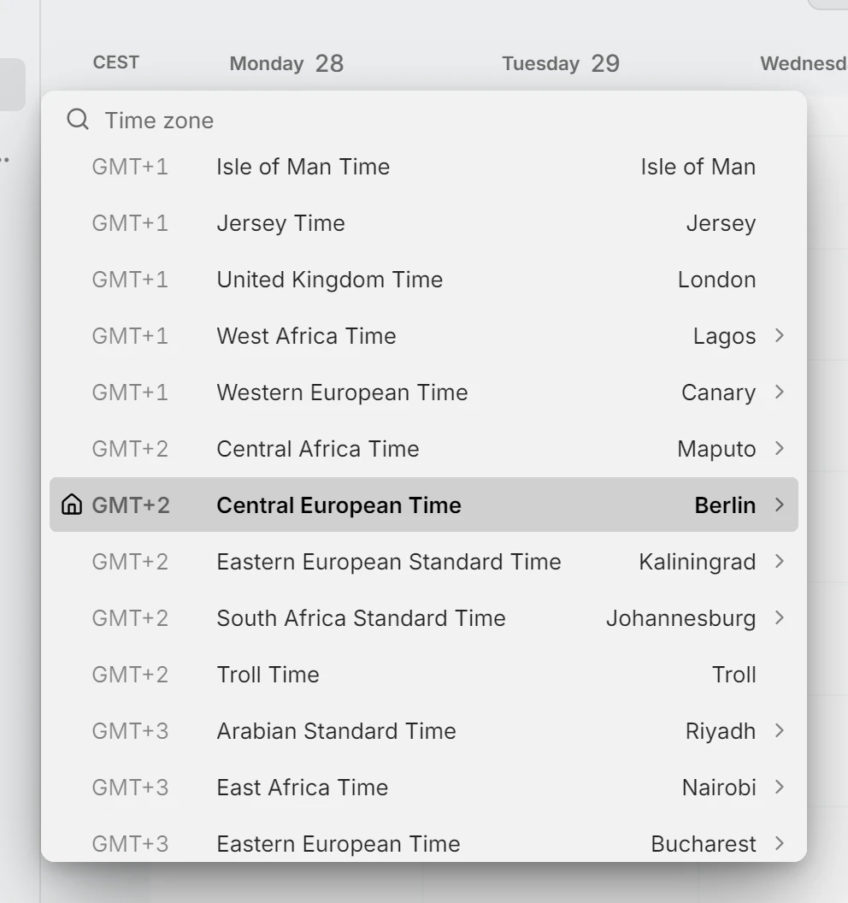
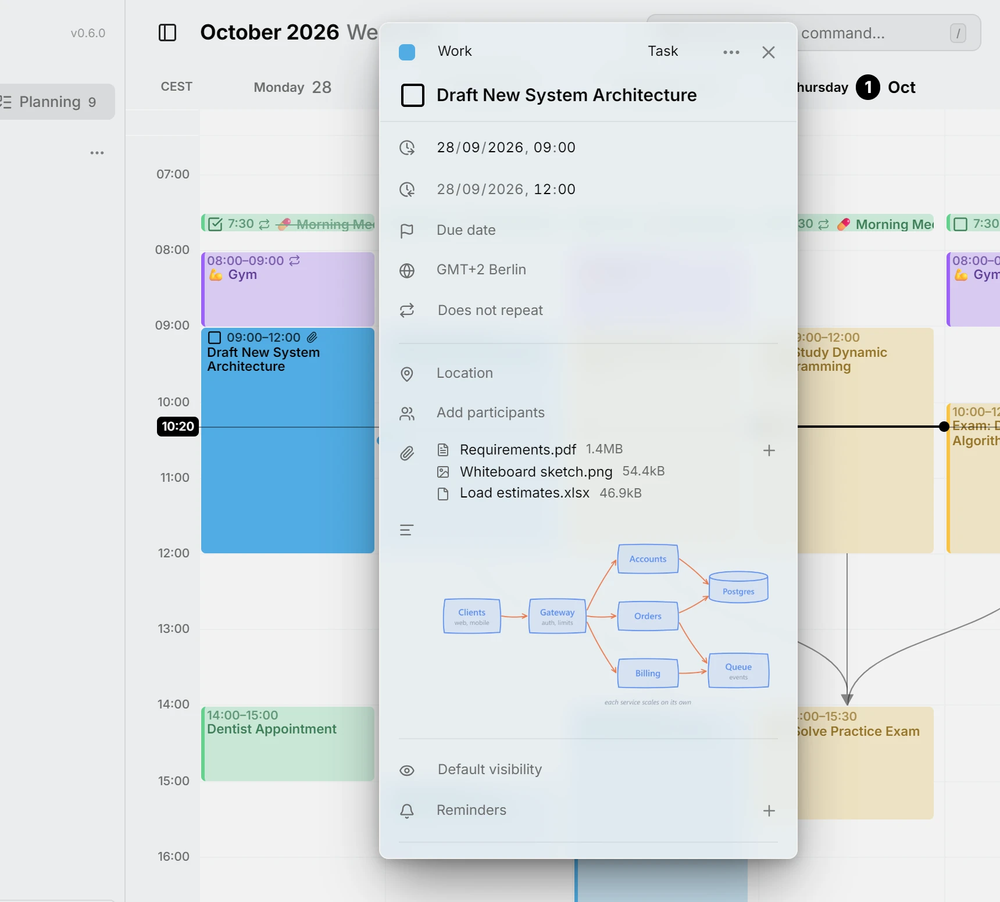
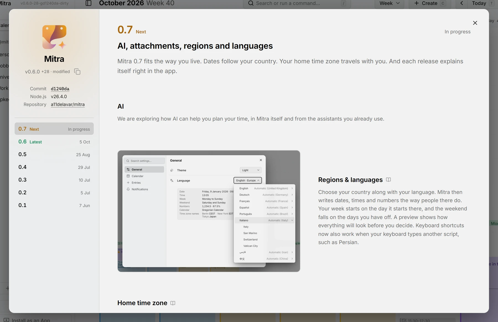
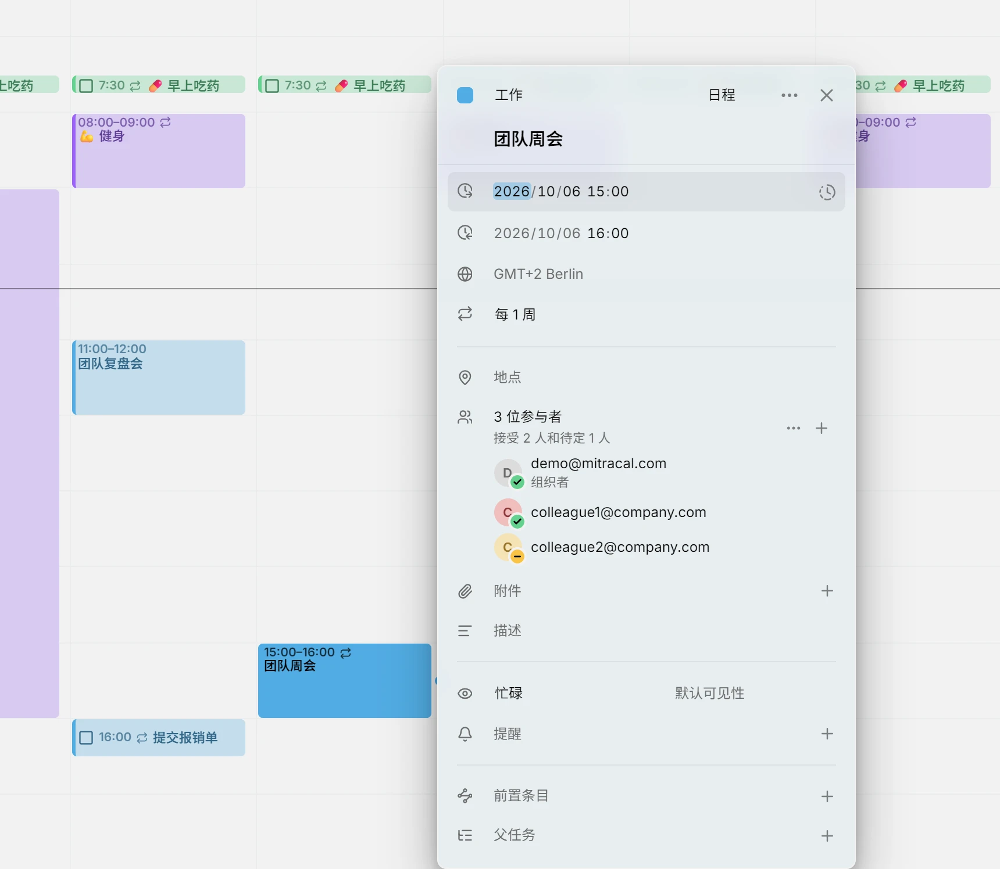

Mitra 0.7 works with the AI assistants you already use, so they can plan your time right in your calendar. You can now attach files to your entries, Mitra writes dates the way your region does, and your home time zone stays with you when you travel. Mitra is now available in Chinese, and you can read what changed without leaving the app. Dragging, zooming and loading are faster too, and there are many smaller improvements and fixes.

## AI connectors
AI assistants such as Claude and Cursor can now work with your calendar. Connect one with the address under Settings → AI, and ask it what you would otherwise do by hand: look at your week, find an entry, plan a trip or move a meeting. What it writes lands in your calendars like any other change, and syncs from there. On a server where people sign in, each assistant gets an access token of its own, which can be limited to reading and revoked at any time.

<picture>
	<source media="(prefers-color-scheme: dark)" srcset="connectors-dark.webp">
	
</picture>

Photo of the Eiffel Tower: David McSpadden, Wikimedia Commons, CC BY 2.0.

Docs: [AI connectors](../../docs/ai-connectors.md)

## Regions & languages
Choose your country along with your language. Mitra then writes dates, times and numbers the way people there do. Your week starts on the day it starts there, and the weekend falls on the days you have off. A preview shows how everything will look before you decide. Keyboard shortcuts now also work when your keyboard types another script, such as Persian.

<picture>
	<source media="(prefers-color-scheme: dark)" srcset="locales-dark.webp">
	
</picture>

Docs: [Settings](../../docs/settings.md)

## Home time zone
Mitra now knows your home time zone and keeps it with your account. When you travel, the calendar follows your device, and your home stays in the column next to it. Your list of zones stays as it was, so you see a single column again when you get back. The zones you add and the names you give them are the same on every device. Each column is headed by the short name people actually use for that zone.

The time zone picker is redesigned as well. Zones that share a name and a clock are grouped into one row, and the zones of your own country come first. A house marks your home, and a pin marks the zone you're in while you travel.

<picture>
	<source media="(prefers-color-scheme: dark)" srcset="time-zones-dark.webp">
	
</picture>

> [!NOTE]
> If you gave the time zone you're in a name of your own, please give it that name once more. Until now, those names stayed on the device where you set them. From now on, a name follows you to every device.

Docs: [Time zones](../../docs/time-zones.md)

## Attachments
You can now attach files to an entry, such as a ticket, an agenda or a photo of a whiteboard. Add them with the paperclip in the entry's editor, or drag them onto the open entry. Click a file to open it. You can also add a file to the description, where an image shows as a picture and any other file as a link. If you remove the file later, Mitra removes it from the description too.

Attachments sync with your calendar. In a CalDAV calendar, other apps that use the same calendar see the files you attach, and Mitra shows the files they attached. In Google Calendar, Mitra shows the Google Drive files attached to an event, but can't add or remove any, because Google only keeps Drive files. Images in a Notion page now show up in the task's description.

<picture>
	<source media="(prefers-color-scheme: dark)" srcset="attachments-dark.webp">
	
</picture>

> [!NOTE]
> Mitra stores the files you attach in its data folder, so backing up that folder also backs up your files. You can limit the size of a single file with `MITRA_FILE_MAX_SIZE`, and how much each person can store in total with `MITRA_FILE_QUOTA`.

Docs: [Attachments](../../docs/attachments.md)

## Release notes in the app
You can now see what changed without leaving Mitra. The About dialog shows each release the way the website does. It has the notes and pictures of the version you run, along with the fixes that came after it. Every commit is listed too, folded away until you need it.

<picture>
	<source media="(prefers-color-scheme: dark)" srcset="about-dark.webp">
	
</picture>

## Chinese
Mitra now speaks Chinese, written in simplified characters. The app, the sample calendar, the docs and the website are all translated, and Chinese text is set in a typeface made for it.

<picture>
	<source media="(prefers-color-scheme: dark)" srcset="chinese-detail-dark.webp">
	
</picture>

Docs: [Settings](../../docs/settings.md)

## Contributors
- [@a11delavar](https://github.com/a11delavar)
- [@d8monx](https://github.com/d8monx)
