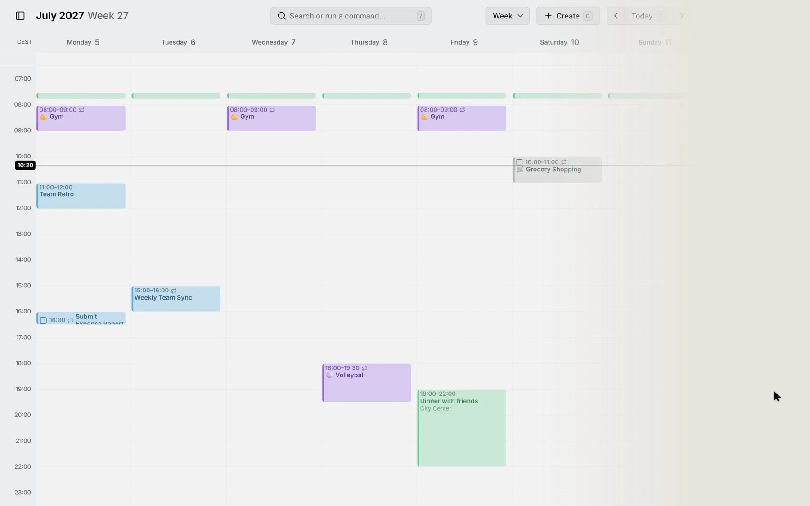
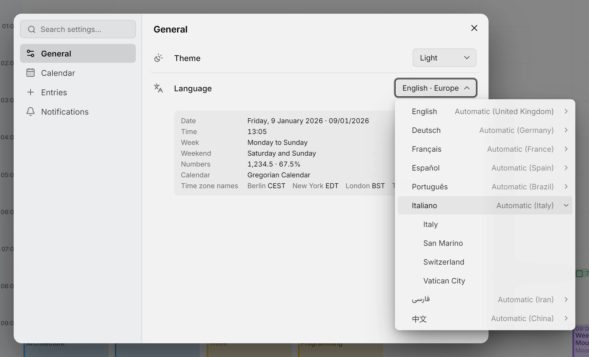
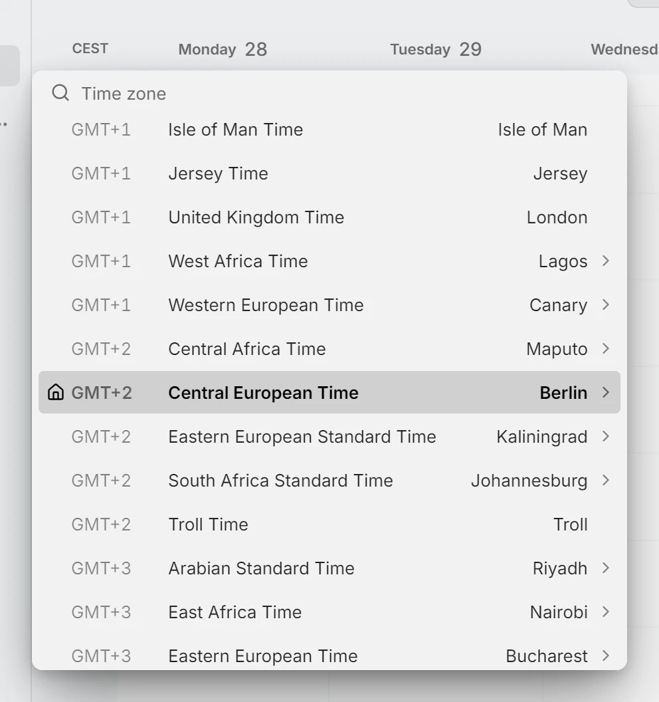
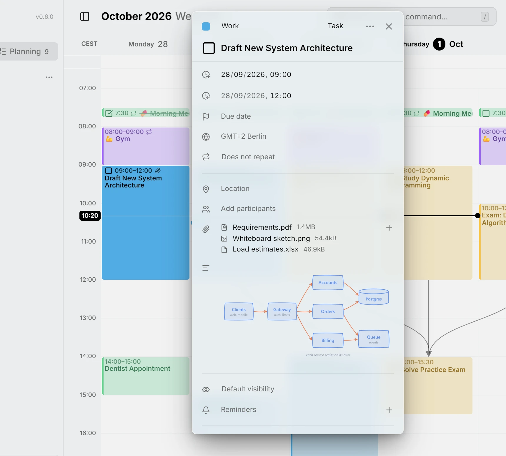
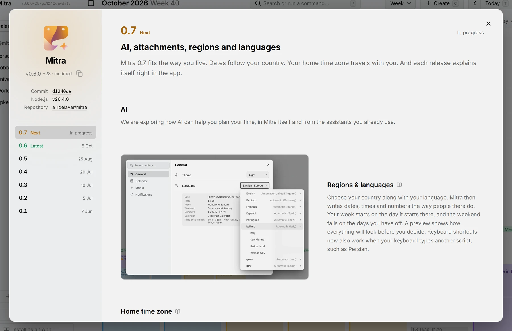
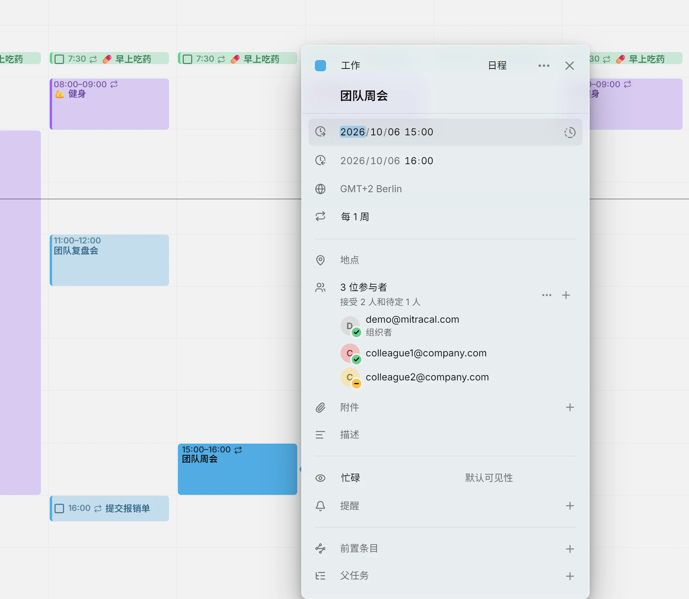

Mitra 0.7 làm việc với các trợ lý AI bạn đang dùng, để chúng có thể lên kế hoạch thời gian ngay trong lịch của bạn. Giờ đây bạn có thể đính kèm tệp vào các mục, Mitra viết ngày tháng theo cách khu vực của bạn viết, và múi giờ chính của bạn đi cùng bạn khi đi xa. Mitra giờ có tiếng Trung, và bạn có thể đọc những gì đã thay đổi mà không cần rời ứng dụng. Việc kéo, thu phóng và tải cũng nhanh hơn, cùng nhiều cải tiến và bản sửa lỗi nhỏ hơn.

## Trình kết nối AI
Các trợ lý AI như Claude và Cursor giờ có thể làm việc với lịch của bạn. Kết nối một trợ lý bằng địa chỉ trong **Cài đặt** → AI, rồi nhờ nó làm những việc bạn vốn phải làm tay: xem tuần của bạn, tìm một mục, lên kế hoạch cho một chuyến đi hay dời một cuộc họp. Những gì nó ghi sẽ vào lịch của bạn như mọi thay đổi khác, và đồng bộ từ đó. Trên máy chủ có người đăng nhập, mỗi trợ lý có một mã truy cập riêng, có thể giới hạn ở quyền đọc và thu hồi bất cứ lúc nào.

<picture>
	<source media="(prefers-color-scheme: dark)" srcset="connectors-dark.webp">
	
</picture>

Ảnh tháp Eiffel: David McSpadden, Wikimedia Commons, CC BY 2.0.

Tài liệu: [Trình kết nối AI](../../docs/ai-connectors.md)

## Khu vực và ngôn ngữ
Chọn quốc gia của bạn cùng với ngôn ngữ. Mitra khi đó viết ngày, giờ và số theo cách người dân ở đó viết. Tuần của bạn bắt đầu vào ngày nó bắt đầu ở đó, và cuối tuần rơi vào những ngày bạn nghỉ. Một bản xem trước cho thấy mọi thứ sẽ trông thế nào trước khi bạn quyết định. Phím tắt giờ cũng hoạt động khi bàn phím của bạn gõ một hệ chữ khác, chẳng hạn tiếng Ba Tư.

<picture>
	<source media="(prefers-color-scheme: dark)" srcset="locales-dark.webp">
	
</picture>

Tài liệu: [Cài đặt](../../docs/settings.md)

## Múi giờ chính
Mitra giờ biết múi giờ chính của bạn và giữ nó cùng tài khoản của bạn. Khi bạn đi xa, lịch theo thiết bị của bạn, còn nhà bạn vẫn ở cột bên cạnh. Danh sách múi giờ của bạn vẫn như cũ, nên bạn lại thấy một cột duy nhất khi trở về. Các múi giờ bạn thêm và tên bạn đặt cho chúng giống nhau trên mọi thiết bị. Mỗi cột có tiêu đề là tên ngắn mà mọi người thực sự dùng cho múi giờ đó.

Bộ chọn múi giờ cũng được thiết kế lại. Các múi giờ có chung tên và đồng hồ được gom thành một hàng, và các múi giờ của chính quốc gia bạn đứng đầu. Một ngôi nhà đánh dấu nhà bạn, và một chiếc ghim đánh dấu múi giờ bạn đang ở khi đi xa.

<picture>
	<source media="(prefers-color-scheme: dark)" srcset="time-zones-dark.webp">
	
</picture>

> [!NOTE]
> Nếu bạn đã đặt tên riêng cho múi giờ đang ở, vui lòng đặt lại tên đó một lần nữa. Cho đến nay, những tên đó chỉ nằm trên thiết bị nơi bạn đặt chúng. Từ giờ, một cái tên đi theo bạn đến mọi thiết bị.

Tài liệu: [Múi giờ](../../docs/time-zones.md)

## Tệp đính kèm
Giờ đây bạn có thể đính kèm tệp vào một mục, chẳng hạn một vé, một chương trình họp hay ảnh chụp bảng trắng. Thêm chúng bằng chiếc kẹp giấy trong trình chỉnh sửa của mục, hoặc kéo chúng vào mục đang mở. Nhấp vào một tệp để mở nó. Bạn cũng có thể thêm một tệp vào mô tả, nơi một ảnh hiện như hình và tệp khác hiện như liên kết. Nếu sau này bạn xóa tệp, Mitra cũng xóa nó khỏi mô tả.

Tệp đính kèm đồng bộ với lịch của bạn. Trong lịch CalDAV, các ứng dụng khác dùng cùng lịch thấy các tệp bạn đính kèm, và Mitra hiện các tệp họ đính kèm. Trong Google Lịch, Mitra hiện các tệp Google Drive đính kèm vào một sự kiện, nhưng không thể thêm hay xóa tệp nào, vì Google chỉ giữ các tệp Drive. Ảnh trong một trang Notion giờ hiện trong mô tả của công việc.

<picture>
	<source media="(prefers-color-scheme: dark)" srcset="attachments-dark.webp">
	
</picture>

> [!NOTE]
> Mitra lưu các tệp bạn đính kèm trong thư mục dữ liệu của nó, nên sao lưu thư mục đó cũng là sao lưu tệp của bạn. Bạn có thể giới hạn dung lượng của một tệp bằng `MITRA_FILE_MAX_SIZE`, và tổng dung lượng mỗi người được lưu bằng `MITRA_FILE_QUOTA`.

Tài liệu: [Tệp đính kèm](../../docs/attachments.md)

## Ghi chú phát hành trong ứng dụng
Giờ đây bạn có thể xem những gì đã thay đổi mà không cần rời Mitra. Hộp thoại Giới thiệu hiển thị từng phiên bản giống như trang web. Nó có ghi chú và hình ảnh của phiên bản bạn đang chạy, cùng các bản sửa lỗi đến sau đó. Mọi commit cũng được liệt kê, gấp lại cho đến khi bạn cần.

<picture>
	<source media="(prefers-color-scheme: dark)" srcset="about-dark.webp">
	
</picture>

## Tiếng Trung
Mitra giờ nói được tiếng Trung, viết bằng chữ giản thể. Ứng dụng, lịch mẫu, tài liệu và trang web đều đã được dịch, và văn bản tiếng Trung được hiển thị bằng một kiểu chữ làm riêng cho nó.

<picture>
	<source media="(prefers-color-scheme: dark)" srcset="chinese-detail-dark.webp">
	
</picture>

Tài liệu: [Cài đặt](../../docs/settings.md)

## Người đóng góp
- [@a11delavar](https://github.com/a11delavar)
- [@d8monx](https://github.com/d8monx)
