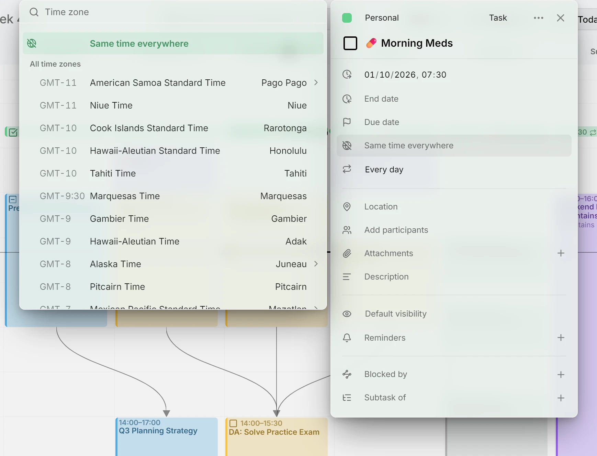
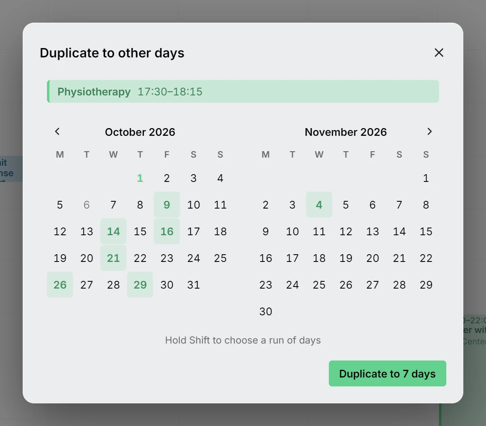
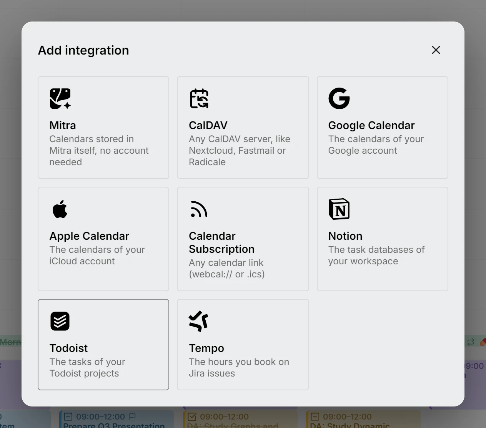
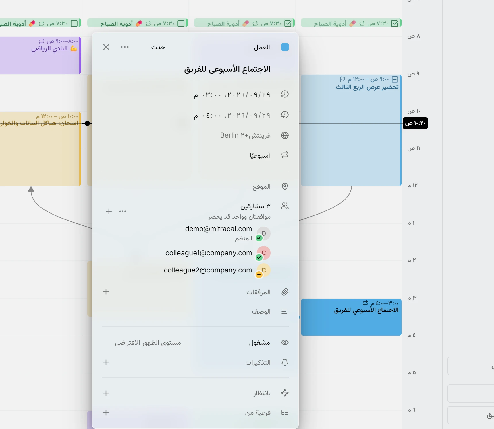

يساعدك Mitra 0.8 على المداومة على ما تفعله مرة بعد مرة، ويُظهر لك كيف تتكوّن الأعمال الكبيرة من أجزائها.

## متتبع الروتين
يجمع Mitra بالفعل ما تفعله كثيرًا، مثل النادي الرياضي أو قص الشعر كل خمسة أسابيع، في صورة روتين. والآن صار للروتين مكان خاص به، ترى فيه الأيام الأخيرة من كل روتين في لمحة: كم مرة التزمت به، وأي المرات ألغيتها أو فاتتك. ويمكنك إعادة تسمية روتين، أو دمج روتينين هما في الحقيقة روتين واحد، أو إخبار Mitra بأن شيئًا ما ليس روتينًا أصلًا. كما يبقى الروتين ثابتًا في عرضي الشهر والسنة مهما مرّرت، ويمكن لموصل الذكاء الاصطناعي أن يخبرك بمدى التزامك به.

## الوقت نفسه في كل مكان
بعض الأشياء لا تتعلق بمنطقتك الزمنية: الدواء الذي تتناوله الساعة 7:30 موعده 7:30، في البيت أو في السفر. اختر **الوقت نفسه في كل مكان** في أعلى قائمة المناطق الزمنية للعنصر، فيبقى عند تلك الساعة أينما كنت، وتميّزه كرة أرضية مشطوبة. والعناصر التي تأتي من تطبيقات أخرى دون منطقة زمنية تحمل هذه العلامة أيضًا. وقبل أن تنقل عنصرًا منها إلى تقويم لا يعرف مثل هذه الأوقات، مثل تقويم Google، يخبرك Mitra بأنه سيحصل على منطقة زمنية ثابتة.

<picture>
	<source media="(prefers-color-scheme: dark)" srcset="same-time-dark.webp">
	
</picture>

التوثيق: [الوقت نفسه في كل مكان](../../docs/time-zones.md#same-time-everywhere)

## مهام فرعية أفضل
تتشارك المهام الفرعية لعنصر ما صفًا واحدًا في عرضي الشهر والسنة، فيظهر المشروع خطًا واحدًا تندمج فيه مهامه الفرعية القصيرة. ويعرض الجدول المهام الفرعية تحت مهمتها الرئيسية، ويمكن إخفاؤها في عرض السنة. ويحسب تقدم المهمة كل مهمة فرعية بحسب حجمها، فيكون للعمل الطويل وزن أكبر من العمل السريع.

## تواريخ الاستحقاق في لمحة
يظهر يوم استحقاق المهمة على رايتها، وعندما تمرّر المؤشر فوق المهمة يتميّز ذلك اليوم في التقويم. ويحدده المخطط الزمني أيضًا، وأصبح للجدول عمود خاص به. والمهمة الفرعية التي ليس لها تاريخ استحقاق خاص بها تأخذ تاريخ استحقاق مهمتها الرئيسية.

## CSS مخصص
غيّر مظهر Mitra باستخدام CSS خاص بك: لنفسك في الإعدادات، أو لكل من يستخدم خادمك عبر ملف في مجلد البيانات. ويحصل من يدير الخادم على قسم خاص به في الإعدادات.

## إنشاء نسخة في أيام أخرى
بعض الأمور تقع في أيام لا يستطيع أي تكرار وصفها. فوصفة بثماني جلسات علاج طبيعي تتوزع على المواعيد الشاغرة في العيادة، وعميل يحجزك في الثالث والتاسع والسابع عشر. أضف الأولى، ثم اختر **إنشاء نسخ في أيام أخرى** من قائمة ⋯ الخاصة بها، وحدد البقية في الشهرين المعروضين. اضغط مع الاستمرار على Shift لاختيار أيام متتالية دفعة واحدة. ويحصل كل يوم على نسخة في الوقت نفسه، وهي عنصر مستقل يمكنك نقله أو تغييره مثل أي عنصر آخر.

<picture>
	<source media="(prefers-color-scheme: dark)" srcset="duplicate-days-dark.webp">
	
</picture>

التوثيق: [إنشاء نسخة في أيام أخرى](../../docs/entries.md#the--menu)

## Todoist
اربط مشاريعك في Todoist، فتظهر مهامها بين أحداثك على الخط الزمني نفسه، مع مزامنة في الاتجاهين. يصبح كل مشروع تقويمًا بلونه في Todoist. ويصبح تاريخ المهمة موعدها، وتصبح مدتها طول هذا الموعد، ويصبح حقل Deadline تاريخ استحقاقها. وتظهر المهمة المتكررة في Todoist في تاريخها القادم، وإكمالها في Mitra ينقلها إلى التاريخ الذي يليه، كما يفعل Todoist. أما الأولوية والتصنيفات والأقسام فتبقى كما هي.

<picture>
	<source media="(prefers-color-scheme: dark)" srcset="todoist-dark.webp">
	
</picture>

التوثيق: [Todoist](../../docs/integrations/todoist.md)

## لغات أكثر
يتعلم Mitra الآن العربية والروسية والبولندية والهولندية. وقد جعل كل إصدار Mitra يعمل بشكل أفضل مع اللغات والخطوط والتقويمات الأخرى. وتأتي كل لغة جديدة مترجمة بالكامل، بما في ذلك التوثيق والموقع الإلكتروني.

<picture>
	<source media="(prefers-color-scheme: dark)" srcset="arabic-week-dark.webp">
	
</picture>

## المساهمون
- [@jkngale](https://github.com/jkngale): الأساس الذي بُني عليه تكامل Todoist
