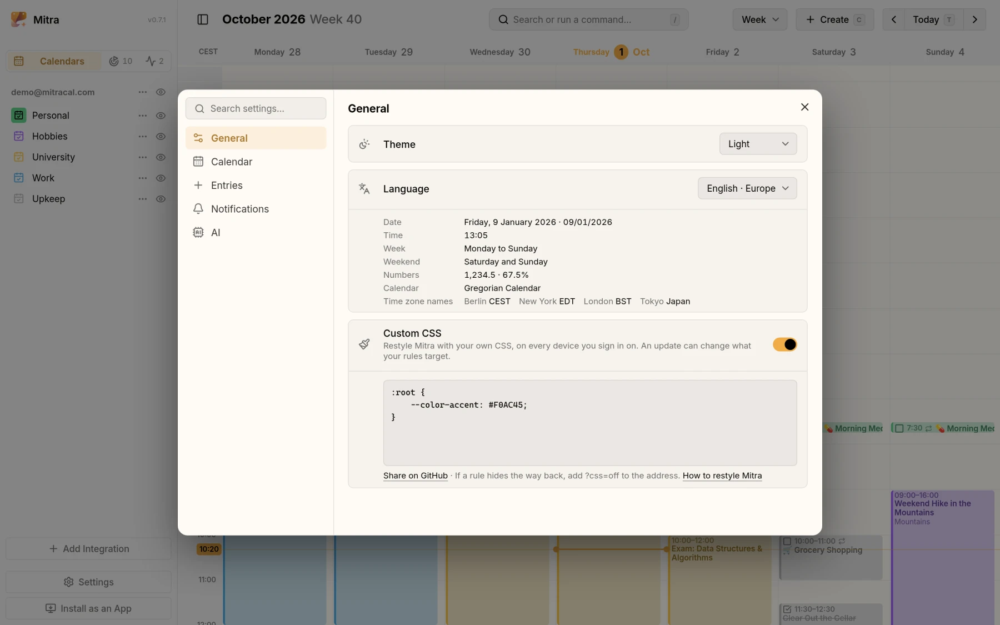
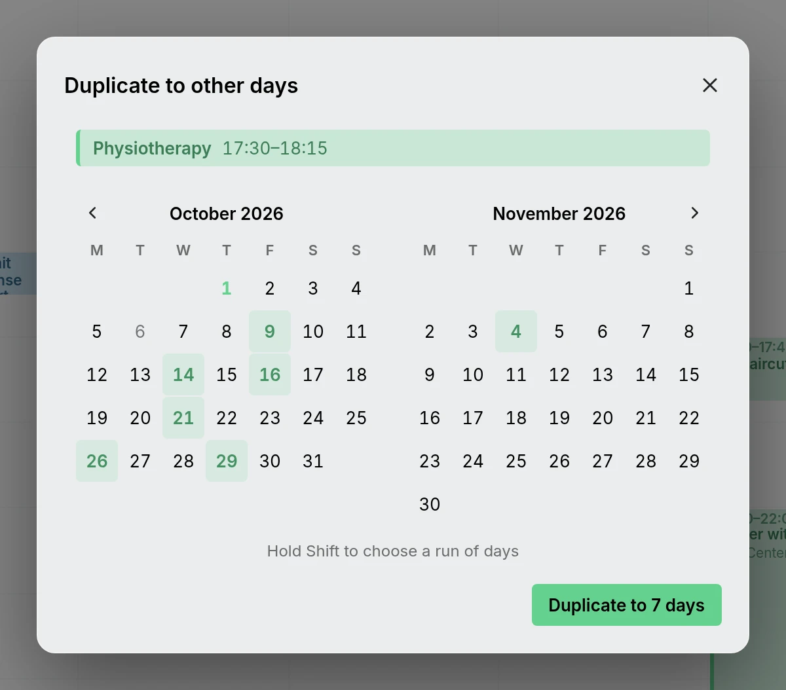

Mitra 0.8 te ayuda a mantener las cosas que haces una y otra vez, y guarda constancia de lo que no llegó a pasar.

## Rutinas y rachas
Mitra ya agrupa en rutinas lo que haces a menudo, como ir al gimnasio o cortarte el pelo cada cinco semanas. Ahora tienen un lugar propio, donde una llama muestra de un vistazo la racha de cada rutina, y su detalle los días que cumpliste, cancelaste o te saltaste. Puedes cambiar el nombre de una rutina, unir dos que van juntas o decirle a Mitra que algo no es una rutina. Las rutinas también se mantienen estables en las vistas de mes y año por mucho que te desplaces, y tu conector de IA puede decirte cómo van.

<picture>
	<source media="(prefers-color-scheme: dark)" srcset="routines-dark.webp">
	
</picture>

Docs: [Rutinas](../../docs/routines.md)

## La misma hora en todas partes
Algunas cosas no dependen de tu zona horaria: la medicación de las 7:30 es a las 7:30, en casa o de viaje. Elige **La misma hora en todas partes** al principio de las zonas horarias de una entrada, y se queda a esa hora estés donde estés, marcada con un globo tachado. Las entradas que llegan de otras aplicaciones sin zona horaria también lo muestran. Antes de que muevas una a un calendario que no tiene esas horas, como Google Calendar, Mitra te avisa de que recibirá una zona horaria fija.

<picture>
	<source media="(prefers-color-scheme: dark)" srcset="same-time-dark.webp">
	
</picture>

Docs: [La misma hora en todas partes](../../docs/time-zones.md#same-time-everywhere)

## Estado del evento
Un evento tiene ahora un estado propio, como una tarea: **Confirmado**, **Quizá** o **Cancelado**. Un evento cancelado conserva su lugar, tachado, así guardas constancia de lo que no llegó a pasar, y tus rutinas lo cuentan. Un quizá aparece atenuado hasta que decidas. El estado se sincroniza con otras apps CalDAV, y la tabla lo muestra junto al de las tareas. **Ocultar tareas completadas** ahora oculta solo las tareas completadas, y el nuevo **Ocultar lo cancelado** oculta las tareas y los eventos cancelados.

<picture>
	<source media="(prefers-color-scheme: dark)" srcset="event-status-dark.webp">
	
</picture>

Docs: [Estado del evento](../../docs/entries.md#event-status)

## Vencimientos de un vistazo
Una tarea programada ahora muestra en su propia bandera cuándo vence, como una hora, un día de la semana o una fecha, según lo pronto que sea. Señala una tarea en la vista de semana o de mes, o en el cronograma, y se estira hasta su fecha de vencimiento, para que veas cuánto margen te queda. Si programaste una tarea para terminar después de su vencimiento, la bandera se vuelve roja. Y la tabla tiene una columna nueva para las fechas de vencimiento.

<picture>
	<source media="(prefers-color-scheme: dark)" srcset="due-stretch-dark.webp">
	
</picture>

Docs: [Fijar una fecha de vencimiento](../../docs/planning.md#set-a-due-date)

## Personalización
Da a cada calendario uno de dos colores más, o el color que quieras. Cambia el nombre del encabezado de una cuenta con un doble clic y oculta todos sus calendarios a la vez.

## CSS personalizado
El aspecto de Mitra es CSS normal, y ahora puedes añadir el tuyo encima. Abre **Ajustes → General → CSS personalizado** y escribe una regla: Mitra la aplica mientras escribes y la guarda en tu cuenta, así que te sigue a todos tus dispositivos. Dale a Mitra tu color favorito, cuadra todas las esquinas u oculta lo que nunca usas. Donde se inicia sesión, quien administra el servidor encuentra además **CSS personalizado para todos** en **Administración**, para darle su aspecto a todo el servidor.

**Compartir en GitHub**, bajo el cuadro, abre una publicación en las [discusiones de Custom CSS](https://github.com/a11delavar/mitra/discussions/categories/custom-css) con tu hoja de estilos ya dentro, y allí también encontrarás lo que han hecho otros. Hasta Mitra 1.0, una actualización puede cambiar aquello a lo que apuntan tus reglas, así que échale un vistazo después de actualizar.

<picture>
	<source media="(prefers-color-scheme: dark)" srcset="custom-css-dark.webp">
	
</picture>

Docs: [CSS personalizado](../../docs/custom-css.md)

## Duplicar en otros días
Algunas cosas ocurren en días que ninguna repetición puede describir. Una receta de ocho sesiones de fisioterapia se reparte entre los huecos libres de la consulta, y un cliente te reserva el 3, el 9 y el 17. Añade la primera, elige **Duplicar en otros días** en su menú ⋯ y marca las demás en los dos meses que aparecen. Mantén pulsado Mayús para elegir varios días seguidos de una vez. Cada día recibe una copia a la misma hora, una entrada propia que puedes mover o cambiar como cualquier otra.

<picture>
	<source media="(prefers-color-scheme: dark)" srcset="duplicate-days-dark.webp">
	
</picture>

Docs: [Duplicar en otros días](../../docs/entries.md#the--menu)

## Todoist
Conecta tus proyectos de Todoist y sus tareas estarán en la misma línea de tiempo que tus eventos, sincronizadas en ambos sentidos. Cada proyecto se convierte en un calendario con su color de Todoist. La fecha, la duración y la fecha límite de una tarea pasan a ser su programación, su duración y su fecha de vencimiento. Una tarea que se repite en Todoist aparece en su próxima fecha, y completarla en Mitra la pasa a la fecha siguiente, como hace Todoist. La prioridad, las etiquetas y las secciones quedan como están.

<picture>
	<source media="(prefers-color-scheme: dark)" srcset="todoist-dark.webp">
	
</picture>

Docs: [Todoist](../../docs/integrations/todoist.md)

## Más idiomas
Mitra está aprendiendo árabe, ruso, polaco y neerlandés. Con cada versión, Mitra funciona mejor en otros idiomas, escrituras y calendarios. Cada idioma nuevo llega traducido por completo, incluidos la documentación y el sitio web.

<picture>
	<source media="(prefers-color-scheme: dark)" srcset="arabic-week-dark.webp">
	
</picture>

## Colaboradores
- [@jkngale](https://github.com/jkngale): las bases para Todoist
