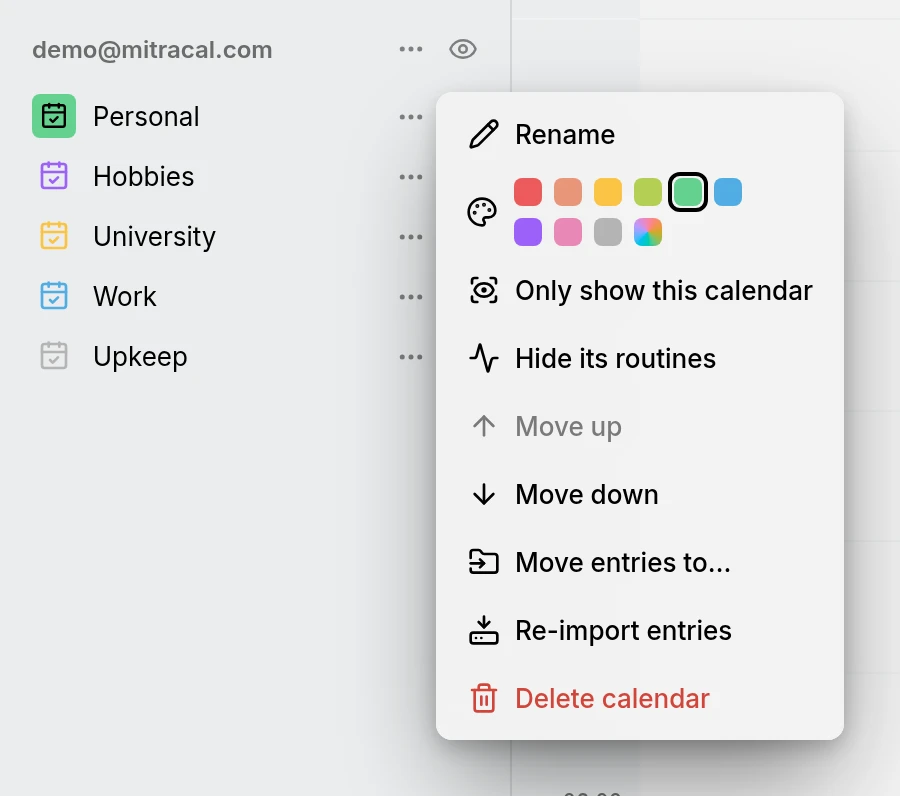

میترا ۰٫۸ کمکتان می‌کند کارهایی را که بارها و بارها انجام می‌دهید ادامه دهید، و آنچه را که انجام نشد ثبت می‌کند.

## روتین‌ها و زنجیره‌ها
میترا از قبل کارهایی را که اغلب انجام می‌دهید، مثل باشگاه یا کوتاه کردن مو هر پنج هفته یک بار، به شکل روتین کنار هم می‌گذارد. حالا این روتین‌ها جای خودشان را دارند، جایی که یک شعله زنجیرهٔ هر روتین را در یک نگاه نشان می‌دهد و جزئیاتش روزهایی را که انجام داده‌اید، لغو شده یا از دست رفته‌اند. می‌توانید نام یک روتین را تغییر دهید، دو روتینی را که به هم تعلق دارند یکی کنید، یا به میترا بگویید که چیزی اصلاً روتین نیست. روتین‌ها در نمای ماه و سال هم هر چقدر که پیمایش کنید ثابت می‌مانند، و اتصال‌دهندهٔ هوش مصنوعی‌تان می‌تواند بگوید وضعشان چطور است. این زبانه اول روتین‌های **امروز** را نشان می‌دهد، بعد روتین‌های **جاری** را، و آن‌هایی را که خیلی وقت پیش بوده‌اند زیر **گذشته** جمع می‌کند. برای کنار گذاشتن روتین‌های یک تقویم، مثل تقویم کارت، در منوی آن **پنهان کردن روتین‌هایش** را انتخاب کن.

<picture>
	<source media="(prefers-color-scheme: dark)" srcset="routines-dark.webp">
	
</picture>

مستندات: [روتین‌ها](../../docs/routines.md)

## همه‌جا همان ساعت
بعضی چیزها به منطقه زمانی شما بستگی ندارند: داروی ساعت ۷:۳۰ همان ساعت ۷:۳۰ است، چه در خانه و چه در سفر. **همه‌جا همان ساعت** را در بالای منطقه‌های زمانی یک مورد انتخاب کنید تا هر جا که باشید در همان ساعت بماند، با نشان کره‌ای خط‌خورده. مواردی که بدون منطقه زمانی از برنامه‌های دیگر می‌آیند هم آن را نشان می‌دهند. پیش از آنکه یکی از آن‌ها را به تقویمی ببرید که چنین زمان‌هایی ندارد، مثل Google Calendar، میترا به شما می‌گوید که منطقه زمانی ثابتی می‌گیرد.

<picture>
	<source media="(prefers-color-scheme: dark)" srcset="same-time-dark.webp">
	
</picture>

مستندات: [همه‌جا همان ساعت](../../docs/time-zones.md#same-time-everywhere)

## وضعیت رویداد
حالا هر رویداد، مثل هر کار، وضعیت خودش را دارد: **تأییدشده**، **شاید** یا **لغوشده**. رویداد لغوشده سر جایش می‌ماند و خط می‌خورد، تا آنچه انجام نشد ثبت بماند، و روتین‌هایتان آن را می‌شمارند. رویدادی که «شاید» است کم‌رنگ نشان داده می‌شود تا تصمیم بگیرید. وضعیت با دیگر برنامه‌های CalDAV همگام می‌شود، و جدول آن را کنار وضعیت کارها نشان می‌دهد. **پنهان کردن کارهای انجام‌شده** حالا فقط کارهای انجام‌شده را پنهان می‌کند، و گزینهٔ تازهٔ **پنهان کردن لغوشده‌ها** کارها و رویدادهای لغوشده را پنهان می‌کند.

<picture>
	<source media="(prefers-color-scheme: dark)" srcset="event-status-dark.webp">
	
</picture>

مستندات: [وضعیت رویداد](../../docs/entries.md#event-status)

## سررسیدها در یک نگاه
حالا هر کار زمان‌بندی‌شده سررسیدش را همان‌جا روی پرچمش نشان می‌دهد، بسته به این‌که چقدر نزدیک باشد به صورت ساعت، روز هفته یا تاریخ. در نمای هفته یا ماه، یا روی خط زمانی، نشانگر را روی یک کار ببرید تا تا سررسیدش کشیده شود و ببینید چقدر فرصت دارید. اگر کاری را طوری زمان‌بندی کرده باشید که بعد از سررسیدش تمام شود، پرچمش قرمز می‌شود. جدول هم حالا ستون تازه‌ای برای سررسیدها دارد.

<picture>
	<source media="(prefers-color-scheme: dark)" srcset="due-stretch-dark.webp">
	
</picture>

مستندات: [تعیین تاریخ سررسید](../../docs/planning.md#set-a-due-date)

## شخصی‌سازی
به هر تقویم یکی از دو رنگ تازه یا هر رنگی که دوست دارید بدهید. نام سرعنوان یک حساب را با دوبار کلیک تغییر دهید و همهٔ تقویم‌هایش را یک‌جا پنهان کنید.

<picture>
	<source media="(prefers-color-scheme: dark)" srcset="personalization-dark.webp">
	
</picture>

## CSS سفارشی
ظاهر میترا CSS معمولی است و حالا می‌توانید CSS خودتان را روی آن بگذارید. **تنظیمات → عمومی → CSS سفارشی** را باز کنید و یک قاعده بنویسید: میترا همان‌طور که می‌نویسید آن را اعمال می‌کند و در حسابتان نگه می‌دارد، پس روی همهٔ دستگاه‌هایتان همراهتان است. رنگ دلخواهتان را به میترا بدهید، همهٔ گوشه‌ها را تیز کنید یا چیزی را که هرگز به کار نمی‌برید پنهان کنید. جایی که افراد وارد حساب می‌شوند، مدیر در **مدیریت** همچنین **CSS سفارشی برای همه** را می‌یابد تا به کل سرور ظاهر خودش را بدهد.

**هم‌رسانی در GitHub** زیر کادر، نوشته‌ای در [گفت‌وگوهای Custom CSS](https://github.com/a11delavar/mitra/discussions/categories/custom-css) آغاز می‌کند که شیوه‌نامهٔ شما از قبل در آن است، و آنچه دیگران ساخته‌اند را هم همان‌جا می‌یابید. تا میترا ۱٫۰، یک به‌روزرسانی می‌تواند چیزهایی را که قاعده‌هایتان هدف می‌گیرند تغییر دهد، پس پس از به‌روزرسانی نگاهی بیندازید.

<picture>
	<source media="(prefers-color-scheme: dark)" srcset="custom-css-dark.webp">
	
</picture>

مستندات: [CSS سفارشی](../../docs/custom-css.md)

## تکثیر در روزهای دیگر
بعضی کارها در روزهایی می‌افتند که هیچ تکراری نمی‌تواند آن‌ها را توصیف کند. نسخهٔ هشت جلسه فیزیوتراپی در وقت‌های خالی مطب پخش می‌شود و مشتری‌ای شما را برای روزهای ۳، ۹ و ۱۷ رزرو می‌کند. اولی را اضافه کنید، از منوی ⋯ آن **تکثیر در روزهای دیگر** را انتخاب کنید و بقیه را در دو ماهی که نشان داده می‌شود علامت بزنید. برای انتخاب یک‌بارهٔ چند روز پشت سر هم، کلید Shift را نگه دارید. هر روز نسخه‌ای در همان ساعت می‌گیرد، موردی مستقل که می‌توانید مانند هر مورد دیگری جابه‌جا یا تغییرش دهید.

<picture>
	<source media="(prefers-color-scheme: dark)" srcset="duplicate-days-dark.webp">
	
</picture>

مستندات: [تکثیر در روزهای دیگر](../../docs/entries.md#the--menu)

## Todoist
پروژه‌های Todoist خود را وصل کنید تا کارهایشان در همان خط زمانی رویدادهایتان قرار بگیرند، با همگام‌سازی در هر دو جهت. هر پروژه به تقویمی با همان رنگی که در Todoist دارد تبدیل می‌شود. تاریخ، مدت و مهلت یک کار، زمان‌بندی، طول و تاریخ سررسید آن می‌شوند. کاری که در Todoist تکرار می‌شود در تاریخ بعدی‌اش نشان داده می‌شود، و انجام دادنش در میترا، مثل Todoist، آن را به تاریخ بعد می‌برد. اولویت، برچسب‌ها و بخش‌ها همان‌طور که هستند می‌مانند.

<picture>
	<source media="(prefers-color-scheme: dark)" srcset="todoist-dark.webp">
	
</picture>

مستندات: [Todoist](../../docs/integrations/todoist.md)

## زبان‌های بیشتر
میترا در حال یادگرفتن عربی، روسی، لهستانی و هلندی است. با هر نسخه، میترا در زبان‌ها، خط‌ها و تقویم‌های دیگر بهتر کار می‌کند. هر زبان تازه کامل ترجمه‌شده از راه می‌رسد، از جمله مستندات و وب‌سایت.

<picture>
	<source media="(prefers-color-scheme: dark)" srcset="arabic-week-dark.webp">
	
</picture>

## مشارکت‌کنندگان
- [@a11delavar](https://github.com/a11delavar)
- [@jkngale](https://github.com/jkngale): زمینه‌سازی برای Todoist
- [@d8monx](https://github.com/d8monx): پیوند مستندات هر یکپارچه‌سازی در پنجره‌ای که آن را وصل می‌کند
- [@libnewton](https://github.com/libnewton): ورودی‌های CalDAV بدون پسوند .ics
