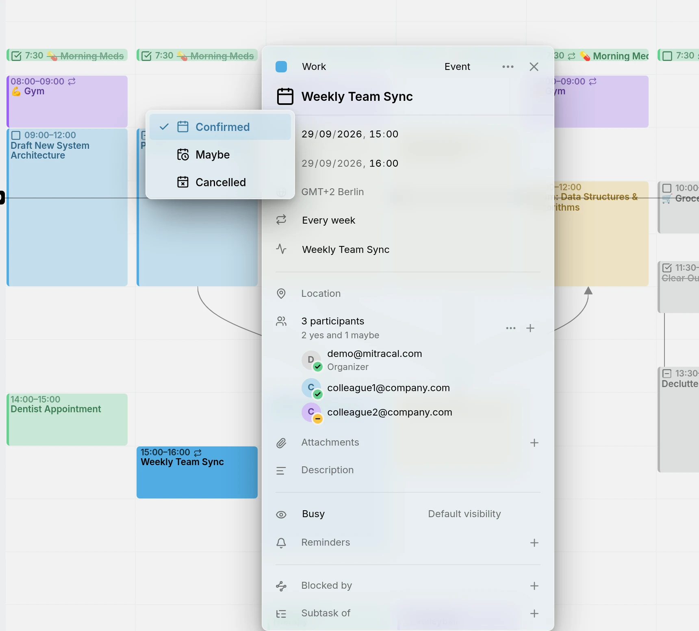

Mitra 0.8 donne à vos routines une place à elles, où vous voyez où en est chacune et entretenez sa série. Mitra se connecte aussi à Todoist, montre quand une tâche arrive à échéance et si un événement est toujours maintenu, et arrive dans quatre langues de plus, avec de nombreuses améliorations et corrections plus modestes.

## Routines et séries
Mitra regroupe déjà en routines ce que vous faites souvent, comme la salle de sport ou une coupe de cheveux toutes les cinq semaines. Elles ont désormais une place à elles, où une flamme montre d'un coup d'œil la série de chaque routine, et son détail les jours tenus, annulés ou manqués. Vous pouvez renommer une routine, fusionner deux routines qui vont ensemble, ou indiquer à Mitra que quelque chose n'est pas une routine. Les routines restent aussi stables dans les vues mois et année, aussi loin que vous fassiez défiler, et votre connecteur IA peut vous dire où elles en sont. L’onglet montre d’abord les routines d’**Aujourd’hui**, puis celles **En cours**, et replie sous **Passées** celles qui remontent à longtemps. Pour écarter les routines d’un calendrier, comme celles de ton calendrier de travail, choisis **Masquer ses routines** dans son menu.

<picture>
	<source media="(prefers-color-scheme: dark)" srcset="routines-dark.webp">
	
</picture>

Documentation : [Routines](../../docs/routines.md)

## Même heure partout
Certaines choses ne dépendent pas de votre fuseau horaire : un médicament à 7 h 30 se prend à 7 h 30, chez vous comme en voyage. Choisissez **Même heure partout** en haut des fuseaux horaires d'une entrée, et elle reste à cette heure où que vous soyez, marquée d'un globe barré. Les entrées venues d'autres applications sans fuseau horaire l'affichent aussi. Avant que vous en déplaciez une vers un calendrier qui n'a pas de telles heures, comme Google Calendar, Mitra vous prévient qu'elle recevra un fuseau horaire fixe.

<picture>
	<source media="(prefers-color-scheme: dark)" srcset="same-time-dark.webp">
	
</picture>

Documentation : [Même heure partout](../../docs/time-zones.md#same-time-everywhere)

## Statut d'un événement
Un événement a désormais son propre statut, comme une tâche : **Confirmé**, **Peut-être** ou **Annulé**. Un événement annulé garde sa place, barré, pour garder une trace de ce qui n'a pas eu lieu, et vos routines le comptent. Un peut-être reste estompé jusqu'à ce que vous décidiez. Le statut se synchronise avec les autres applications CalDAV, et le tableau l'affiche à côté de celui des tâches. **Masquer les tâches terminées** ne masque plus que les tâches terminées, et le nouveau **Masquer les éléments annulés** masque les tâches et les événements annulés.

<picture>
	<source media="(prefers-color-scheme: dark)" srcset="event-status-dark.webp">
	
</picture>

Documentation : [Statut d'un événement](../../docs/entries.md#event-status)

## Les échéances en un coup d'œil
Une tâche planifiée affiche désormais son échéance directement sur son drapeau, sous forme d'heure, de jour de la semaine ou de date, selon qu'elle est proche ou non. Pointez une tâche dans la vue semaine ou mois, ou sur la chronologie, et elle s'étire jusqu'à son échéance, pour que vous voyiez la marge qu'il vous reste. Si vous avez planifié une tâche pour finir après son échéance, le drapeau devient rouge. Et le tableau a une nouvelle colonne pour les échéances.

<picture>
	<source media="(prefers-color-scheme: dark)" srcset="due-stretch-dark.webp">
	
</picture>

Documentation : [Fixer une échéance](../../docs/planning.md#set-a-due-date)

## Personnalisation
Donnez à chaque calendrier l'une de deux nouvelles couleurs, ou la couleur de votre choix. Renommez l'en-tête d'un compte d'un double-clic et masquez tous ses calendriers d'un coup.

<picture>
	<source media="(prefers-color-scheme: dark)" srcset="personalization-dark.webp">
	
</picture>

## CSS personnalisé
L'apparence de Mitra est du CSS ordinaire, et vous pouvez maintenant ajouter le vôtre par-dessus. Ouvrez **Paramètres → Général → CSS personnalisé** et saisissez une règle : Mitra l'applique pendant que vous tapez et la garde dans votre compte, si bien qu'elle vous suit sur tous vos appareils. Donnez à Mitra votre couleur préférée, rendez tous les angles carrés ou masquez ce que vous n'utilisez jamais. Là où l'on se connecte, un administrateur trouve aussi **CSS personnalisé pour tous** sous **Administration**, pour donner son apparence à tout le serveur.

**Partager sur GitHub**, sous la zone, ouvre une publication dans les [discussions Custom CSS](https://github.com/a11delavar/mitra/discussions/categories/custom-css) avec votre feuille de style déjà dedans, et c'est aussi là que vous trouverez ce que d'autres ont fait. Jusqu'à Mitra 1.0, une mise à jour peut changer ce que visent vos règles : jetez-y un œil après chaque mise à jour.

<picture>
	<source media="(prefers-color-scheme: dark)" srcset="custom-css-dark.webp">
	
</picture>

Documentation : [CSS personnalisé](../../docs/custom-css.md)

## Dupliquer sur d'autres jours
Certaines choses tombent des jours qu'aucune répétition ne sait décrire. Une ordonnance de huit séances de kinésithérapie se cale sur les créneaux libres du cabinet, et un client vous réserve le 3, le 9 et le 17. Ajoutez la première, choisissez **Dupliquer sur d'autres jours** dans son menu ⋯ et cochez les autres sur les deux mois affichés. Maintenez Maj pour choisir plusieurs jours d'affilée d'un coup. Chaque jour reçoit une copie à la même heure, une entrée à part entière que vous pouvez déplacer ou modifier comme n'importe quelle autre.

<picture>
	<source media="(prefers-color-scheme: dark)" srcset="duplicate-days-dark.webp">
	
</picture>

Documentation : [Dupliquer sur d'autres jours](../../docs/entries.md#the--menu)

## Todoist
Connectez vos projets Todoist, et leurs tâches prennent place sur la même chronologie que vos événements, synchronisées dans les deux sens. Chaque projet devient un calendrier avec sa couleur de Todoist. La date, la durée et l'échéance d'une tâche deviennent sa planification, sa durée et sa date d'échéance. Une tâche récurrente dans Todoist apparaît à sa prochaine date, et la terminer dans Mitra la fait passer à la date suivante, comme le fait Todoist. La priorité, les étiquettes et les sections restent telles quelles.

<picture>
	<source media="(prefers-color-scheme: dark)" srcset="todoist-dark.webp">
	
</picture>

Documentation : [Todoist](../../docs/integrations/todoist.md)

## Plus de langues
Mitra apprend l'arabe, le russe, le polonais et le néerlandais. À chaque version, Mitra fonctionne mieux dans d'autres langues, écritures et calendriers. Chaque nouvelle langue arrive entièrement traduite, documentation et site web compris.

<picture>
	<source media="(prefers-color-scheme: dark)" srcset="arabic-week-dark.webp">
	
</picture>

## Contributeurs
- [@a11delavar](https://github.com/a11delavar)
- [@jkngale](https://github.com/jkngale)
- [@d8monx](https://github.com/d8monx)
- [@libnewton](https://github.com/libnewton)
