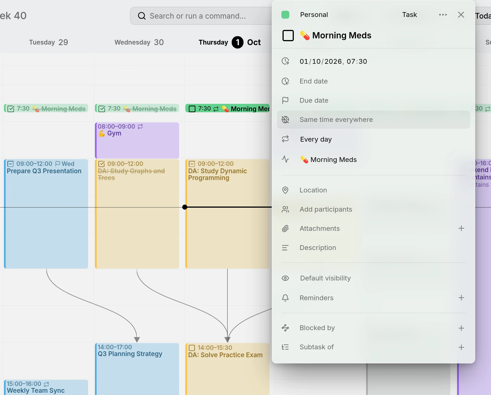

Mitra 0.8では、ルーティンに専用の場所ができ、それぞれの調子を見て連続記録を続けられます。Todoistとも連携し、タスクの期日や予定が実施されるかどうかも分かるようになります。新たに4つの言語にも対応し、小さな改善と修正もたくさんあります。

## ルーティンと連続記録
Mitraはこれまでも、ジム通いや5週ごとの散髪のようによくやることをルーティンにまとめてきました。今回、専用の場所ができ、炎のマークで各ルーティンの連続記録が一目で分かり、詳細には達成・キャンセル・未達成の日が並びます。ルーティンの名前を変えたり、一緒にするべき2つを統合したり、ルーティンではないとMitraに伝えたりできます。どれだけスクロールしても、月ビューと年ビューではルーティンが安定して表示され、AIコネクタが調子を教えてくれます。タブには **今日** のルーティンが先に来て、次に **継続中**、ずっと前のものは **過去** に折りたたまれます。仕事のカレンダーなど、あるカレンダーのルーティンを外したいときは、そのメニューで **ルーティンを隠す** を選びます。

<picture>
	<source media="(prefers-color-scheme: dark)" srcset="routines-dark.webp">
	
</picture>

ドキュメント：[ルーティン](../../docs/routines.md)

## どこでも同じ時刻
タイムゾーンに関係ないこともあります。7:30の薬は、家でも旅先でも7:30です。項目のタイムゾーンの一番上で **どこでも同じ時刻** を選ぶと、どこにいてもその時刻のままになり、取り消し線の入った地球マークが付きます。ほかのアプリからタイムゾーンなしで来た項目にも表示されます。そのような時刻を持たないカレンダー（Googleカレンダーなど）へ移すときは、固定のタイムゾーンが付くことをMitraが事前に伝えます。

<picture>
	<source media="(prefers-color-scheme: dark)" srcset="same-time-dark.webp">
	
</picture>

ドキュメント：[どこでも同じ時刻](../../docs/time-zones.md#same-time-everywhere)

## 予定のステータス
予定にもタスクと同じようにステータスが付きました。**確定**、**未定**、**キャンセル**です。キャンセル済みの予定は取り消し線付きでその場に残るので、なかったことの記録が残り、ルーティンもそれを数えます。未定の予定は決めるまで薄く表示されます。ステータスはほかのCalDAVアプリと同期し、テーブルにもタスクの横に表示されます。**完了したタスクを非表示** は完了したタスクだけを隠すようになり、新しい **キャンセル済みを非表示** はキャンセル済みのタスクと予定を隠します。

<picture>
	<source media="(prefers-color-scheme: dark)" srcset="event-status-dark.webp">
	
</picture>

ドキュメント：[予定のステータス](../../docs/entries.md#event-status)

## 一目で分かる期日
予定のあるタスクは、期日を旗に直接表示するようになりました。近さに応じて時刻、曜日、日付で表示されます。週ビュー、月ビュー、タイムラインでタスクにポインターを合わせると、期日まで伸びるので、どれだけ余裕があるか見えます。期日を過ぎて終わるように予定を組むと、旗が赤くなります。テーブルにも期日の列が新しくできました。

<picture>
	<source media="(prefers-color-scheme: dark)" srcset="due-stretch-dark.webp">
	
</picture>

ドキュメント：[計画](../../docs/planning.md#set-a-due-date)

## カスタマイズ
カレンダーごとに、新しく追加された2色のどれか、または好きな色を選べます。アカウントの見出しはダブルクリックで名前を変えられ、そのカレンダーすべてを一度に隠せます。

<picture>
	<source media="(prefers-color-scheme: dark)" srcset="personalization-dark.webp">
	
</picture>

## カスタムCSS
Mitraの見た目はただのCSSで、その上に自分のCSSを重ねられます。**設定 → 一般 → カスタムCSS** を開いてルールを入力すると、入力するそばからMitraに反映され、アカウントに保存されるので、どのデバイスにも付いてきます。Mitraを好きな色に染め、すべての角を直角にし、使わないものを隠すこともできます。サインインするサーバーでは、管理者が **管理** に **全員向けカスタムCSS** も見つけられ、サーバー全体の見た目を決められます。

ボックスの下の **GitHubで共有** を押すと、[カスタムCSSのディスカッション](https://github.com/a11delavar/mitra/discussions/categories/custom-css)にスタイルシート入りの投稿が始まります。ほかの人の作品もそこで見つかります。Mitra 1.0までは、更新でルールの対象が変わることがあるので、アップデート後に確認してください。

<picture>
	<source media="(prefers-color-scheme: dark)" srcset="custom-css-dark.webp">
	
</picture>

ドキュメント：[カスタムCSS](../../docs/custom-css.md)

## ほかの日に複製
繰り返しでは表せない日に起きることもあります。8回分の理学療法の処方はクリニックの空きに応じてばらばらに入り、クライアントは3日、9日、17日に予約を入れます。最初の1件を追加して、その⋯メニューで **ほかの日に複製** を選び、表示される2か月分で残りの日にチェックを付けます。Shiftを押しながらだと連続した日をまとめて選べます。各日に同じ時刻のコピーができ、それぞれ独立した項目として、ほかと同じように移動や変更ができます。

<picture>
	<source media="(prefers-color-scheme: dark)" srcset="duplicate-days-dark.webp">
	
</picture>

ドキュメント：[ほかの日に複製](../../docs/entries.md#the--menu)

## Todoist
Todoistのプロジェクトを接続すると、そのタスクが予定と同じタイムラインに並び、双方向に同期されます。各プロジェクトはTodoistの色のカレンダーになります。タスクの日付・所要時間・締め切りは、その予定・長さ・期日になります。Todoistで繰り返すタスクは次の日付に表示され、Mitraで完了すると、Todoistと同じように次へ進みます。優先度、ラベル、セクションはそのままです。

<picture>
	<source media="(prefers-color-scheme: dark)" srcset="todoist-dark.webp">
	
</picture>

ドキュメント：[Todoist](../../docs/integrations/todoist.md)

## 対応言語の追加
Mitraはアラビア語、ロシア語、ポーランド語、オランダ語を学習中です。リリースごとに、ほかの言語・文字・暦での動作が良くなってきました。新しい言語は、ドキュメントとウェブサイトを含めてすべて翻訳された状態で届きます。

<picture>
	<source media="(prefers-color-scheme: dark)" srcset="arabic-week-dark.webp">
	
</picture>

## コントリビューター
- [@a11delavar](https://github.com/a11delavar)
- [@jkngale](https://github.com/jkngale)
- [@d8monx](https://github.com/d8monx)
- [@libnewton](https://github.com/libnewton)
