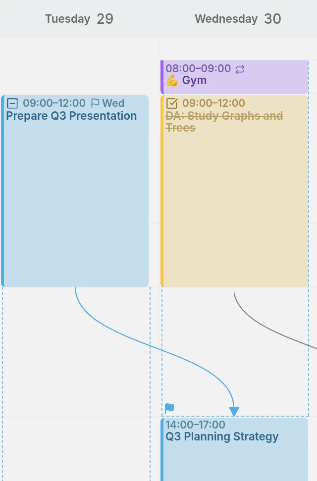

Mitra 0.8 helps you keep up the things you do again and again, and keeps a record of what didn't happen.

## Routine tracker
Mitra already gathers the things you do often, such as the gym or a haircut every five weeks, into routines. Now they get a place of their own, where you see each routine's recent days at a glance: how many you kept, and which you cancelled or missed. You can rename a routine, merge two that belong together, or tell Mitra that something isn't a routine at all. Routines also stay steady in the month and year views however far you scroll, and your AI connector can tell you how they are going.

## Same time everywhere
Some things don't depend on your time zone: medication at 7:30 is at 7:30, at home or when you travel. Choose **Same time everywhere** at the top of an entry's time zones, and it stays at that hour wherever you are, marked with a crossed-out globe. Entries that come from other apps without a time zone show it too. Before you move one to a calendar that has no such times, such as Google Calendar, Mitra tells you it will get a fixed time zone.

<picture>
	<source media="(prefers-color-scheme: dark)" srcset="same-time-dark.webp">
	
</picture>

Docs: [Same time everywhere](../../docs/time-zones.md#same-time-everywhere)

## Event status
An event now has a status of its own, as a task does: **Confirmed**, **Maybe** or **Cancelled**. A cancelled event keeps its place, struck through, so you keep a record of what didn't happen, and your routines count it. A maybe is faded until you decide. The status syncs with other CalDAV apps, and the table lists it beside the tasks'. **Hide done tasks** now hides done tasks alone, and the new **Hide cancelled** hides cancelled tasks and events.

<picture>
	<source media="(prefers-color-scheme: dark)" srcset="event-status-dark.webp">
	
</picture>

Docs: [Event status](../../docs/entries.md#event-status)

## Due dates at a glance
A scheduled task now shows when it's due right on its flag, as a time, a weekday or a date, depending on how soon it is. Point at a task in the week or month view, or on the timeline, and it stretches out to its due date, so you can see how much room is left. If you've scheduled a task to finish after it's due, the flag turns red. And the table has a new column for due dates.

<picture>
	<source media="(prefers-color-scheme: dark)" srcset="due-stretch-dark.webp">
	
</picture>

Docs: [Planning](../../docs/planning.md#set-a-due-date)

## Personalization
Give each calendar one of two more colors, or any color you like. Rename an account's heading by double-clicking it, and hide all of its calendars at once. For everything beyond that, restyle Mitra with CSS of your own: for yourself in Settings, or for everyone on your server through a file in its data folder. Whoever runs the server gets a section of their own in Settings.

## Duplicate to other days
Some things happen on days no repeat can describe. A prescription for eight physiotherapy sessions lands wherever the practice has a free slot, and a client books you for the 3rd, the 9th and the 17th. Add the first one, choose **Duplicate to other days** in its ⋯ menu, and tick the rest on the two months it shows. Hold Shift to take a run of days at once. Each day gets a copy at the same time, an entry of its own that you can move or change like any other.

<picture>
	<source media="(prefers-color-scheme: dark)" srcset="duplicate-days-dark.webp">
	
</picture>

Docs: [Duplicate to other days](../../docs/entries.md#the--menu)

## Todoist
Connect your Todoist projects, and their tasks sit on the same timeline as your events, synced both ways. Each project becomes a calendar in its Todoist color. A task's date, duration and deadline become its schedule, its length and its due date. A task that repeats in Todoist shows at its next date, and completing it in Mitra moves it on, as Todoist does. Priority, labels and sections stay as they are.

<picture>
	<source media="(prefers-color-scheme: dark)" srcset="todoist-dark.webp">
	
</picture>

Docs: [Todoist](../../docs/integrations/todoist.md)

## More languages
Mitra is learning Arabic, Russian, Polish and Dutch. Each release has made Mitra work better in other languages, scripts and calendars. Every new language comes fully translated, including the docs and the website.

<picture>
	<source media="(prefers-color-scheme: dark)" srcset="arabic-week-dark.webp">
	
</picture>

## Contributors
- [@jkngale](https://github.com/jkngale): the groundwork for Todoist
