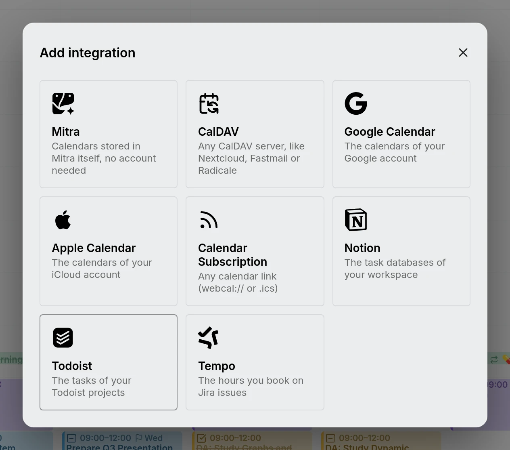

O Mitra 0.8 dá às suas rotinas um lugar próprio, onde você vê como cada uma está indo e mantém a sua sequência. O Mitra também se conecta ao Todoist, mostra quando uma tarefa vence e se um evento ainda está de pé, e chega em mais quatro idiomas, com muitas melhorias e correções menores.

## Rotinas e sequências
O Mitra já reúne em rotinas o que você faz com frequência, como a academia ou um corte de cabelo a cada cinco semanas. Agora elas ganham um lugar próprio, onde uma chama mostra de relance a sequência de cada rotina, e o seu detalhe os dias que você cumpriu, cancelou ou perdeu. Você pode renomear uma rotina, juntar duas que andam juntas ou dizer ao Mitra que algo não é uma rotina. As rotinas também ficam estáveis nas visualizações de mês e ano, por mais que você role, e o seu conector de IA pode dizer como elas estão indo. A aba mostra primeiro as rotinas de **Hoje**, depois as que estão **Em curso**, e recolhe em **Passadas** as que ficaram muito para trás. Para deixar de fora as rotinas de um calendário, como as do calendário de trabalho, escolha **Ocultar as rotinas** no menu dele.

<picture>
	<source media="(prefers-color-scheme: dark)" srcset="routines-dark.webp">
	
</picture>

Documentação: [Rotinas](../../docs/routines.md)

## Mesmo horário em todo lugar
Algumas coisas não dependem do seu fuso horário: o remédio das 7:30 é às 7:30, em casa ou em viagem. Escolha **Mesmo horário em todo lugar** no topo dos fusos horários de uma entrada, e ela fica nesse horário onde quer que você esteja, marcada com um globo riscado. Entradas que chegam de outros aplicativos sem fuso horário também mostram isso. Antes que você mova uma delas para um calendário que não tem horários assim, como o Google Calendar, o Mitra avisa que ela vai receber um fuso horário fixo.

<picture>
	<source media="(prefers-color-scheme: dark)" srcset="same-time-dark.webp">
	
</picture>

Documentação: [Mesmo horário em todo lugar](../../docs/time-zones.md#same-time-everywhere)

## Estado do evento
Um evento agora tem um estado próprio, como uma tarefa: **Confirmado**, **Talvez** ou **Cancelado**. Um evento cancelado mantém o seu lugar, riscado, para você guardar o registro do que não aconteceu, e as suas rotinas o contam. Um talvez fica esmaecido até você decidir. O estado é sincronizado com outros apps CalDAV, e a tabela o mostra ao lado do das tarefas. **Ocultar tarefas concluídas** agora oculta só as tarefas concluídas, e o novo **Ocultar cancelados** oculta tarefas e eventos cancelados.

<picture>
	<source media="(prefers-color-scheme: dark)" srcset="event-status-dark.webp">
	
</picture>

Documentação: [Estado do evento](../../docs/entries.md#event-status)

## Vencimentos de relance
Uma tarefa agendada agora mostra na própria bandeira quando vence, como uma hora, um dia da semana ou uma data, conforme a proximidade. Aponte para uma tarefa na visualização de semana ou de mês, ou na linha do tempo, e ela se estica até a data de vencimento, para você ver quanta folga ainda tem. Se você agendou uma tarefa para terminar depois do vencimento, a bandeira fica vermelha. E a tabela tem uma coluna nova para as datas de vencimento.

<picture>
	<source media="(prefers-color-scheme: dark)" srcset="due-stretch-dark.webp">
	
</picture>

Documentação: [Definir uma data de vencimento](../../docs/planning.md#set-a-due-date)

## Personalização
Dê a cada calendário uma de duas novas cores, ou a cor que quiser. Renomeie o cabeçalho de uma conta com um clique duplo e oculte todos os calendários dela de uma vez.

<picture>
	<source media="(prefers-color-scheme: dark)" srcset="personalization-dark.webp">
	
</picture>

## CSS personalizado
A aparência do Mitra é CSS comum, e agora você pode acrescentar o seu por cima. Abra **Configurações → Geral → CSS personalizado** e digite uma regra: o Mitra a aplica enquanto você digita e a guarda na sua conta, então ela acompanha você em todos os dispositivos. Dê ao Mitra a sua cor favorita, deixe todos os cantos retos ou esconda o que você nunca usa. Onde as pessoas entram com uma conta, quem administra o servidor também encontra **CSS personalizado para todos** em **Administração**, para dar ao servidor inteiro a aparência dele.

**Compartilhar no GitHub**, abaixo da caixa, começa uma publicação nas [discussões de Custom CSS](https://github.com/a11delavar/mitra/discussions/categories/custom-css) com a sua folha de estilo já dentro, e é lá também que você encontra o que outras pessoas fizeram. Até o Mitra 1.0, uma atualização pode mudar aquilo que as suas regras atingem, então dê uma olhada depois de atualizar.

<picture>
	<source media="(prefers-color-scheme: dark)" srcset="custom-css-dark.webp">
	
</picture>

Documentação: [CSS personalizado](../../docs/custom-css.md)

## Duplicar em outros dias
Algumas coisas acontecem em dias que nenhuma repetição consegue descrever. Uma receita de oito sessões de fisioterapia se encaixa nos horários livres da clínica, e um cliente reserva você para os dias 3, 9 e 17. Adicione a primeira, escolha **Duplicar em outros dias** no menu ⋯ dela e marque as demais nos dois meses exibidos. Segure Shift para escolher vários dias seguidos de uma vez. Cada dia recebe uma cópia no mesmo horário, uma entrada própria que você pode mover ou alterar como qualquer outra.

<picture>
	<source media="(prefers-color-scheme: dark)" srcset="duplicate-days-dark.webp">
	
</picture>

Documentação: [Duplicar em outros dias](../../docs/entries.md#the--menu)

## Todoist
Conecte os seus projetos do Todoist, e as tarefas deles ficam na mesma linha do tempo que os seus eventos, sincronizadas nos dois sentidos. Cada projeto vira um calendário com a sua cor do Todoist. A data, a duração e o prazo de uma tarefa passam a ser o seu agendamento, a sua duração e a sua data de vencimento. Uma tarefa que se repete no Todoist aparece na sua próxima data, e concluí-la no Mitra a passa para a data seguinte, como o Todoist faz. A prioridade, as etiquetas e as seções continuam como estão.

<picture>
	<source media="(prefers-color-scheme: dark)" srcset="todoist-dark.webp">
	
</picture>

Documentação: [Todoist](../../docs/integrations/todoist.md)

## Mais idiomas
O Mitra está aprendendo árabe, russo, polonês e holandês. A cada versão, o Mitra funciona melhor em outros idiomas, escritas e calendários. Cada novo idioma chega totalmente traduzido, incluindo a documentação e o site.

<picture>
	<source media="(prefers-color-scheme: dark)" srcset="arabic-week-dark.webp">
	
</picture>

## Colaboradores
- [@a11delavar](https://github.com/a11delavar)
- [@jkngale](https://github.com/jkngale)
- [@d8monx](https://github.com/d8monx)
- [@libnewton](https://github.com/libnewton)
