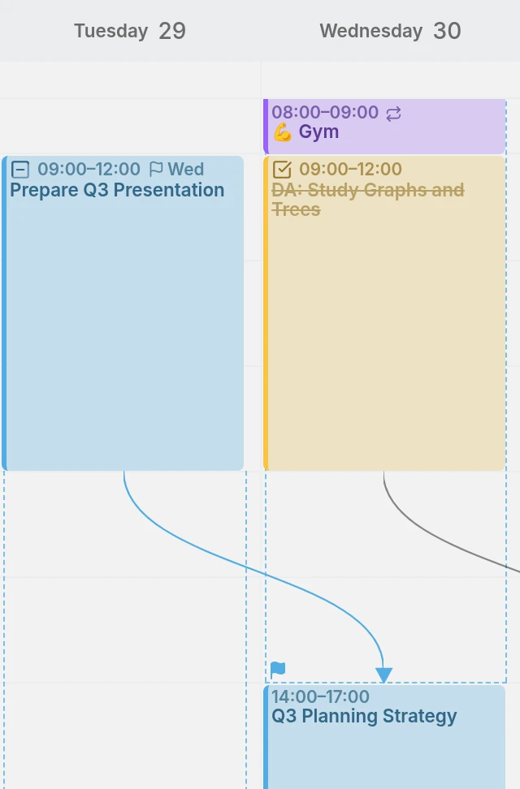
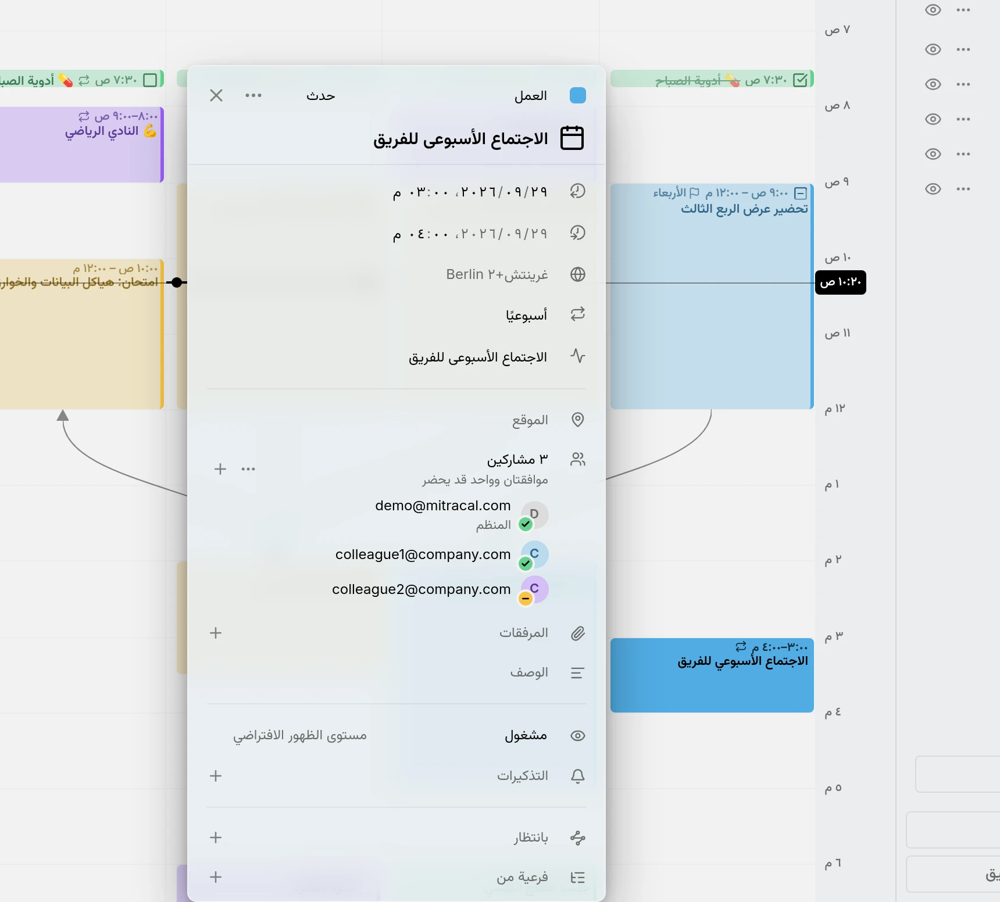

Mitra 0.8 cho các thói quen của bạn một chỗ riêng, nơi bạn thấy từng thói quen đang diễn ra thế nào và giữ chuỗi liên tiếp của nó. Mitra cũng kết nối với Todoist, cho thấy khi nào một công việc đến hạn và một sự kiện có còn diễn ra không, và có thêm bốn ngôn ngữ, cùng nhiều cải tiến và sửa lỗi nhỏ hơn.

## Thói quen và chuỗi liên tiếp
Mitra vốn đã gom những việc bạn làm thường xuyên, như đi tập gym hay cắt tóc mỗi năm tuần, thành các thói quen. Giờ chúng có một chỗ riêng, nơi một ngọn lửa cho thấy chuỗi liên tiếp của từng thói quen trong một cái nhìn, và phần chi tiết cho thấy những ngày bạn đã giữ, đã hủy hoặc đã bỏ lỡ. Bạn có thể đổi tên một thói quen, gộp hai thói quen thuộc về nhau, hoặc báo cho Mitra rằng thứ đó hoàn toàn không phải thói quen. Các thói quen cũng ổn định trong chế độ xem tháng và năm dù bạn cuộn xa đến đâu, và trình kết nối AI của bạn có thể cho bạn biết chúng đang diễn ra thế nào. Thẻ này liệt kê các thói quen diễn ra **Hôm nay** trước, rồi các thói quen **Đang duy trì**, và thu gọn những thói quen đã lâu không diễn ra vào **Đã qua**. Để bỏ qua các thói quen của một lịch, chẳng hạn lịch công việc, hãy chọn **Ẩn các thói quen của lịch** trong menu của lịch đó.

<picture>
	<source media="(prefers-color-scheme: dark)" srcset="routines-dark.webp">
	
</picture>

Tài liệu: [Thói quen](../../docs/routines.md)

## Cùng một giờ ở mọi nơi
Một số việc không phụ thuộc múi giờ của bạn: uống thuốc lúc 7:30 là lúc 7:30, ở nhà hay khi đi xa. Chọn **Cùng một giờ ở mọi nơi** ở đầu các múi giờ của một mục, và nó giữ nguyên giờ đó dù bạn ở đâu, được đánh dấu bằng một quả địa cầu gạch chéo. Các mục đến từ ứng dụng khác mà không có múi giờ cũng hiện như vậy. Trước khi bạn chuyển một mục sang lịch không có kiểu giờ như vậy, chẳng hạn Google Lịch, Mitra cho bạn biết nó sẽ nhận một múi giờ cố định.

<picture>
	<source media="(prefers-color-scheme: dark)" srcset="same-time-dark.webp">
	
</picture>

Tài liệu: [Cùng một giờ ở mọi nơi](../../docs/time-zones.md#same-time-everywhere)

## Trạng thái sự kiện
Một sự kiện giờ có trạng thái riêng, như một công việc: **Đã xác nhận**, **Có thể** hoặc **Đã hủy**. Một sự kiện đã hủy giữ nguyên chỗ của nó, bị gạch ngang, để bạn giữ bản ghi về những gì đã không xảy ra, và các thói quen của bạn tính nó. Một sự kiện “có thể” bị làm mờ cho đến khi bạn quyết định. Trạng thái đồng bộ với các ứng dụng CalDAV khác, và bảng liệt kê nó bên cạnh trạng thái của công việc. **Ẩn công việc đã xong** giờ chỉ ẩn các công việc đã xong, còn **Ẩn mục đã hủy** mới ẩn các công việc và sự kiện đã hủy.

<picture>
	<source media="(prefers-color-scheme: dark)" srcset="event-status-dark.webp">
	
</picture>

Tài liệu: [Trạng thái sự kiện](../../docs/entries.md#event-status)

## Hạn chót trong tầm mắt
Một công việc đã lên lịch giờ hiện hạn của nó ngay trên cờ, dưới dạng giờ, thứ trong tuần hoặc ngày, tùy theo mức gần. Trỏ vào một công việc trong chế độ xem tuần hoặc tháng, hoặc trên dòng thời gian, và nó kéo dài ra đến hạn chót, để bạn thấy còn bao nhiêu chỗ. Nếu bạn đã lên lịch một công việc kết thúc sau hạn, cờ chuyển sang đỏ. Và bảng có một cột mới cho hạn chót.

<picture>
	<source media="(prefers-color-scheme: dark)" srcset="due-stretch-dark.webp">
	
</picture>

Tài liệu: [Kế hoạch](../../docs/planning.md#set-a-due-date)

## Cá nhân hóa
Cho mỗi lịch một trong hai màu nữa, hoặc bất kỳ màu nào bạn thích. Đổi tên tiêu đề của một tài khoản bằng cách nhấp đúp vào nó, và ẩn tất cả các lịch của nó cùng lúc.

<picture>
	<source media="(prefers-color-scheme: dark)" srcset="personalization-dark.webp">
	
</picture>

## CSS tùy chỉnh
Giao diện của Mitra là CSS thuần, và giờ bạn có thể thêm CSS của riêng mình lên trên. Mở **Cài đặt → Chung → CSS tùy chỉnh** và gõ một quy tắc: Mitra áp dụng nó ngay khi bạn gõ và lưu nó trong tài khoản của bạn, nên nó theo bạn đến mọi thiết bị. Cho Mitra màu bạn yêu thích, làm vuông mọi góc hoặc ẩn những gì bạn không bao giờ dùng. Ở nơi mọi người đăng nhập, quản trị viên còn thấy **CSS tùy chỉnh cho mọi người** trong **Quản trị**, để đặt giao diện cho cả máy chủ.

**Chia sẻ trên GitHub** dưới ô nhập sẽ bắt đầu một bài đăng trong [các thảo luận về Custom CSS](https://github.com/a11delavar/mitra/discussions/categories/custom-css) với bảng định kiểu của bạn có sẵn trong đó, và đó cũng là nơi tìm những gì người khác đã làm. Cho đến Mitra 1.0, một bản cập nhật có thể thay đổi những gì quy tắc của bạn nhắm tới, nên hãy xem lại sau khi cập nhật.

<picture>
	<source media="(prefers-color-scheme: dark)" srcset="custom-css-dark.webp">
	
</picture>

Tài liệu: [CSS tùy chỉnh](../../docs/custom-css.md)

## Nhân bản sang ngày khác
Có những việc xảy ra vào các ngày mà không quy tắc lặp lại nào mô tả được. Một đơn thuốc cho tám buổi vật lý trị liệu rơi vào bất cứ khung giờ trống nào của phòng khám, và một khách hàng đặt lịch bạn vào ngày 3, 9 và 17. Thêm buổi đầu tiên, chọn **Nhân bản sang ngày khác** trong menu ⋯ của nó, và đánh dấu các ngày còn lại trên hai tháng được hiển thị. Giữ Shift để chọn một dải ngày cùng lúc. Mỗi ngày nhận một bản sao vào cùng giờ, là một mục riêng mà bạn có thể di chuyển hay thay đổi như mọi mục khác.

<picture>
	<source media="(prefers-color-scheme: dark)" srcset="duplicate-days-dark.webp">
	
</picture>

Tài liệu: [Nhân bản sang ngày khác](../../docs/entries.md#the--menu)

## Todoist
Kết nối các dự án Todoist của bạn, và các công việc của chúng nằm trên cùng dòng thời gian với sự kiện của bạn, đồng bộ hai chiều. Mỗi dự án trở thành một lịch với màu Todoist của nó. Ngày, thời lượng và hạn chót của một công việc trở thành lịch trình, độ dài và hạn chót của nó. Một công việc lặp lại trong Todoist hiện ở ngày kế tiếp của nó, và hoàn thành nó trong Mitra sẽ đẩy nó đi tiếp, như Todoist làm. Mức ưu tiên, nhãn và các phần vẫn như cũ.

<picture>
	<source media="(prefers-color-scheme: dark)" srcset="todoist-dark.webp">
	
</picture>

Tài liệu: [Todoist](../../docs/integrations/todoist.md)

## Thêm ngôn ngữ
Mitra đang học tiếng Ả Rập, Nga, Ba Lan và Hà Lan. Mỗi phiên bản đã giúp Mitra hoạt động tốt hơn trong các ngôn ngữ, hệ chữ và lịch khác. Mỗi ngôn ngữ mới đều được dịch đầy đủ, gồm cả tài liệu và trang web.

<picture>
	<source media="(prefers-color-scheme: dark)" srcset="arabic-week-dark.webp">
	
</picture>

## Người đóng góp
- [@a11delavar](https://github.com/a11delavar)
- [@jkngale](https://github.com/jkngale)
- [@d8monx](https://github.com/d8monx)
- [@libnewton](https://github.com/libnewton)
