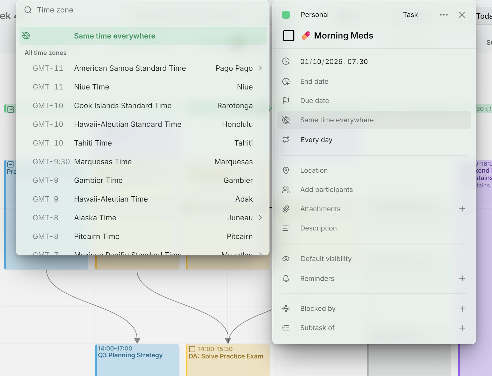
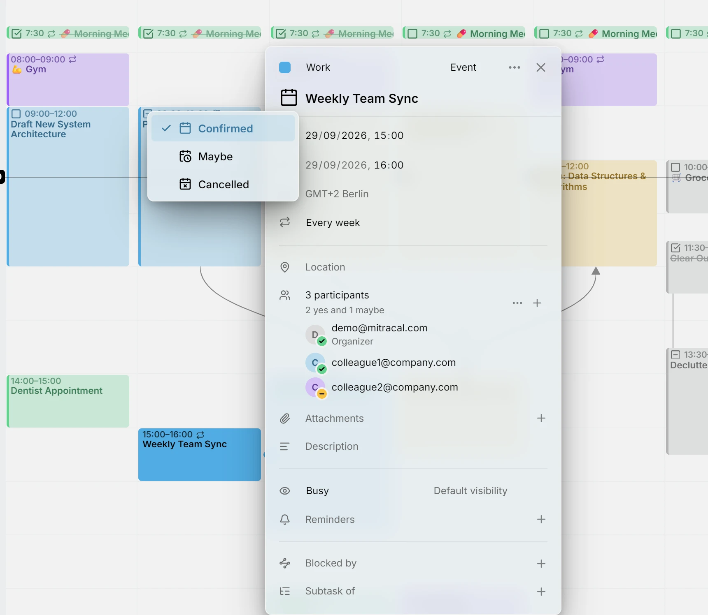
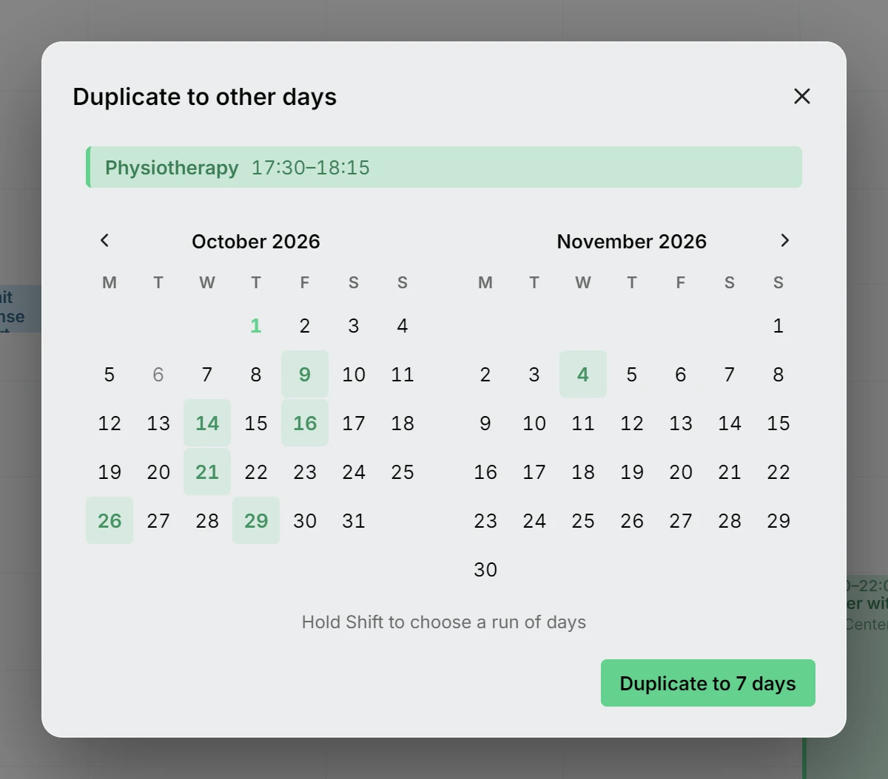
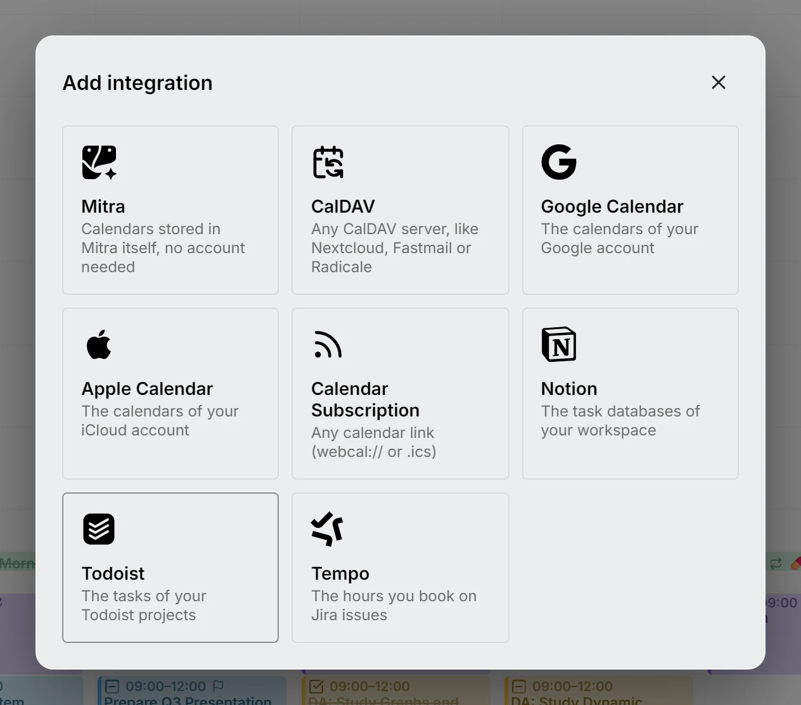
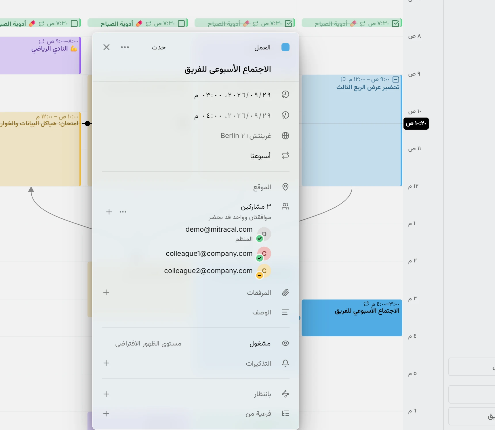

Mitra 0.8 帮你坚持那些反复要做的事，并记下没有发生的事。

## 例行事项追踪
Mitra 已经会把你经常做的事归为例行事项，比如去健身房，或者每五周理一次发。现在它们有了自己的位置，你可以一眼看到每个例行事项最近的日子：完成了多少次，哪些取消了或错过了。你可以给例行事项改名，把属于一起的两个合并，或者告诉 Mitra 某件事根本不是例行事项。无论你滚动多远，例行事项在月视图和年视图中都保持稳定，你的 AI 连接器也能告诉你它们的进展。

## 各地时间相同
有些事情与你的时区无关：7:30 的药无论在家还是在旅途中，都在 7:30 吃。在条目时区列表的顶部选择 **各地时间相同**，无论你身在何处，它都停留在那个钟点，并以划掉的地球图标标出。从其他应用导入的没有时区的条目也会这样显示。在你把这样的条目移到不支持这种时间的日历（例如 Google 日历）之前，Mitra 会告诉你它将被固定到一个时区。

<picture>
	<source media="(prefers-color-scheme: dark)" srcset="same-time-dark.webp">
	
</picture>

文档：[各地时间相同](../../docs/time-zones.md#same-time-everywhere)

## 日程状态
日程现在像任务一样有了自己的状态：**已确认**、**待定**或**已取消**。已取消的日程保留在原位，显示为删除线，让你留下没有发生的记录，例行事项也会把它计算在内。待定的日程会淡化显示，直到你做出决定。状态会与其他 CalDAV 应用同步，表格也会把它和任务的状态并列显示。**隐藏已完成的任务** 现在只隐藏已完成的任务，新的 **隐藏已取消** 则隐藏已取消的任务和日程。

<picture>
	<source media="(prefers-color-scheme: dark)" srcset="event-status-dark.webp">
	
</picture>

文档：[日程状态](../../docs/entries.md#event-status)

## 截止日期一目了然
任务的截止日会显示在它的旗标上，把指针移到任务上时，日历中会标出那一天。时间线也会标出它，表格还会多出一列。

## 个性化
为每个日历选择两种新颜色之一，或任意你喜欢的颜色。双击账户的标题即可重命名，还可以一次隐藏它的所有日历。其余的一切，都可以用你自己的 CSS 改变 Mitra 的外观：在设置中只为你自己生效，或者通过服务器数据文件夹里的一个文件对服务器上的所有人生效。服务器的管理员会在设置中拥有一个专属区域。

## 在其他日期创建副本
有些事情落在任何重复规则都描述不了的日子里。八次物理治疗的处方要按诊所的空档来排，客户又约了你 3 号、9 号和 17 号。先添加第一次，在它的 ⋯ 菜单中选择**在其他日期创建副本**，再在显示的两个月里勾选其余的日子。按住 Shift 可一次选好连续的几天。每一天都会得到一份同一时间的副本，它是一个独立的条目，可以像其他条目一样移动或修改。

<picture>
	<source media="(prefers-color-scheme: dark)" srcset="duplicate-days-dark.webp">
	
</picture>

文档：[在其他日期创建副本](../../docs/entries.md#the--menu)

## Todoist
连接你的 Todoist 项目，它们的任务会和你的日程出现在同一条时间线上，并双向同步。每个项目都会成为一个日历，沿用它在 Todoist 中的颜色。任务的日期、时长和最后期限会成为它的时间安排、长度和截止日期。在 Todoist 中重复的任务显示在它的下一个日期。在 Mitra 中完成它，它会像在 Todoist 中一样推到下一个日期。优先级、标签和分区保持不变。

<picture>
	<source media="(prefers-color-scheme: dark)" srcset="todoist-dark.webp">
	
</picture>

文档：[Todoist](../../docs/integrations/todoist.md)

## 更多语言
Mitra 正在学习阿拉伯语、俄语、波兰语和荷兰语。每个版本都让 Mitra 在其他语言、文字和历法中运行得更好。每种新语言都会完整翻译，包括文档和网站。

<picture>
	<source media="(prefers-color-scheme: dark)" srcset="arabic-week-dark.webp">
	
</picture>

## 贡献者
- [@jkngale](https://github.com/jkngale)：Todoist 集成的基础工作
