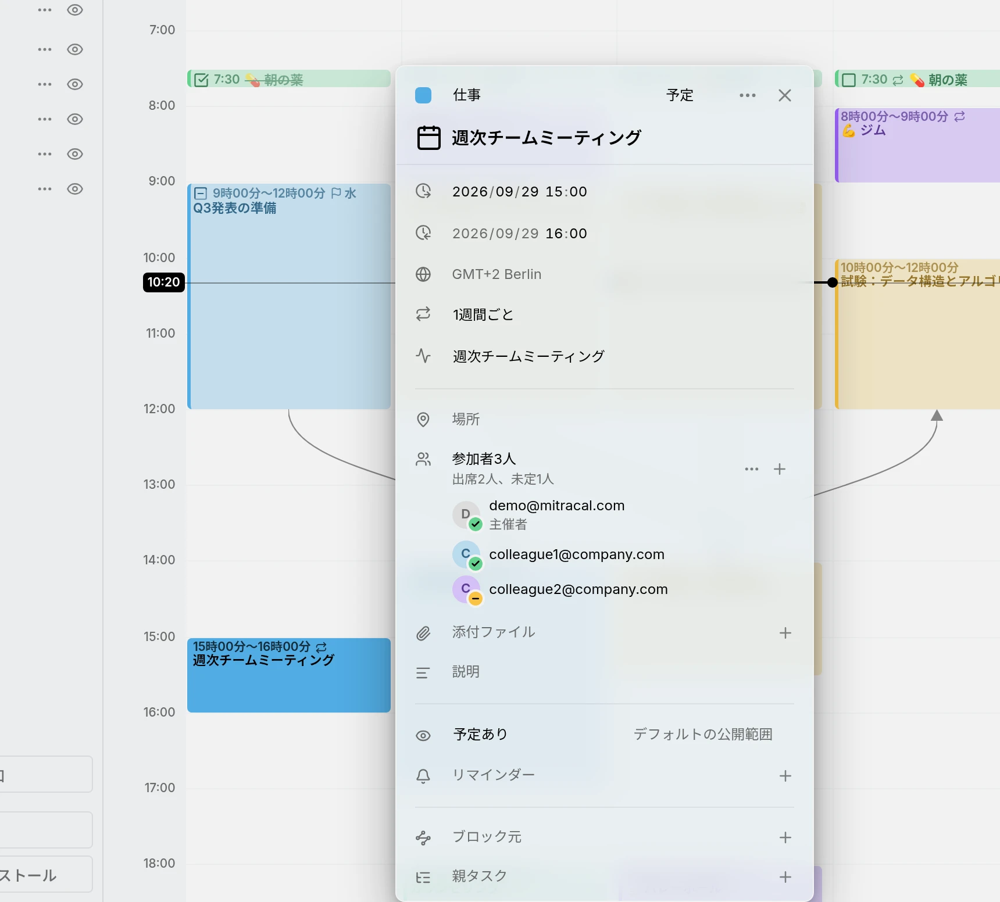

Mitra 0.9はまだ計画中です。大きな作業をひとまとまりにして次にできることを示し、サイドバーをあなたの考え方に合わせ、日付をあなたの読み方で書きます。

## サブタスクの改善
項目のサブタスクは月ビューと年ビューでひとつのレーンを共有するので、プロジェクトが1行として読め、短いサブタスクはその中に折りたたまれます。テーブルはサブタスクを親の下に入れ子にし、年ビューでは隠せます。タスクの進捗はサブタスクを大きさで重み付けするので、長い作業は短い作業より大きく数えられ、予定はその下のタスクの進捗を表示します。独自の期日を持たないサブタスクは親の期日を受け継ぎます。

## カレンダーの自由なグループ化
アカウントごとのグループ化に加えて、サイドバーのカレンダーを自分好みにグループ化し、グループ全体を一度に表示・非表示できます。

## 高度なロケールビルダー
言語と地域だけでなく、日付を書く暦、数字、週の始まりの曜日、時計まで選べます。ペルシャ暦のような第2のカレンダーを日付の横に表示でき、現在のタイムゾーンを手動で設定することもできます。

## いまできるタスク
計画タブに、ほかの未完了タスクにブロックされていない未完了タスクが専用のセクションに並ぶので、いますぐ取り組めることが一目で分かります。

## ブロックされたタスクへの警告
ほかの未完了タスクにまだブロックされているタスクを完了しようとすると、事前に確認が入ります。順番を飛ばして終わらせるのが事故ではなく選択になります。

## TickTick連携
TickTickアカウントを接続すると、そのリストがタスクのカレンダーとしてMitraに入り、双方向に同期されます。

## あなたのいる場所への通知
リマインダーが、ntfy、Apprise、独自のwebhookなど、すでに使っているツールに届きます。

## 対応言語の追加
Mitraは日本語、韓国語、ベトナム語に対応しました。どの言語もドキュメントとウェブサイトまで含めてすべて翻訳されています。日本語と韓国語はそれぞれのために作られた書体で表示されます。

<picture>
	<source media="(prefers-color-scheme: dark)" srcset="japanese-week-dark.webp">
	
</picture>

## コントリビューター
- [@a11delavar](https://github.com/a11delavar)
- [@Mugwort150](https://github.com/Mugwort150)
