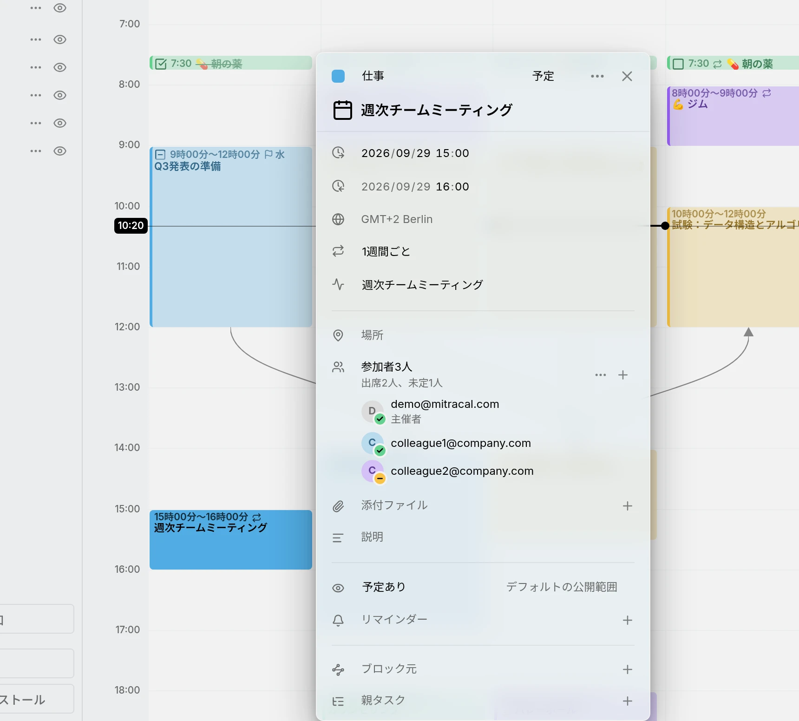

O Mitra 0.9 ainda está sendo planejado. Ele junta os trabalhos maiores e mostra o que pode ser feito em seguida, deixa a barra lateral seguir o seu jeito de pensar e escreve as datas como você as lê.

## Subtarefas melhores
As subtarefas de uma entrada dividem uma faixa nas visualizações de mês e ano, então um projeto se lê como uma só linha, com as subtarefas curtas recolhidas dentro dela. A tabela aninha as subtarefas sob a sua entrada principal, e a visualização de ano pode ocultá-las. O progresso de uma tarefa pesa cada subtarefa pelo seu tamanho, então um trabalho longo conta mais do que um rápido, e um evento mostra o progresso das tarefas abaixo dele. Uma subtarefa sem data de vencimento própria usa a da sua entrada principal.

## Agrupamento próprio de calendários
Agrupe os calendários da barra lateral do seu jeito, ao lado do agrupamento por conta, e oculte ou mostre um grupo inteiro de uma vez.

## Configurador avançado de região
Escolha mais do que um idioma e uma região: o calendário em que as suas datas são escritas, os dígitos, o primeiro dia da semana e o relógio. Um segundo calendário, como o persa, pode aparecer ao lado das suas datas, e você pode definir à mão o seu fuso horário atual.

## Tarefas que dá para fazer agora
Planeamento lista numa seção própria as tarefas abertas que nenhuma outra tarefa aberta bloqueia, então fica claro no que você pode trabalhar agora mesmo.

## Aviso em tarefas bloqueadas
Concluir uma tarefa que outra tarefa aberta ainda bloqueia pede confirmação antes, então terminar fora de ordem é uma escolha e não um acidente.

## Integração com o TickTick
Conecte sua conta do TickTick, e as listas dela chegam ao Mitra como calendários de tarefas, sincronizados nos dois sentidos.

## Notificações onde você está
Os lembretes chegam às ferramentas que você já usa, como ntfy, Apprise ou o seu próprio webhook.

## Mais idiomas
O Mitra agora fala japonês, coreano e vietnamita, cada um totalmente traduzido, incluindo a documentação e o site. O japonês e o coreano aparecem em fontes feitas para eles.

<picture>
	<source media="(prefers-color-scheme: dark)" srcset="japanese-week-dark.webp">
	
</picture>

## Colaboradores
- [@a11delavar](https://github.com/a11delavar)
- [@Mugwort150](https://github.com/Mugwort150)
