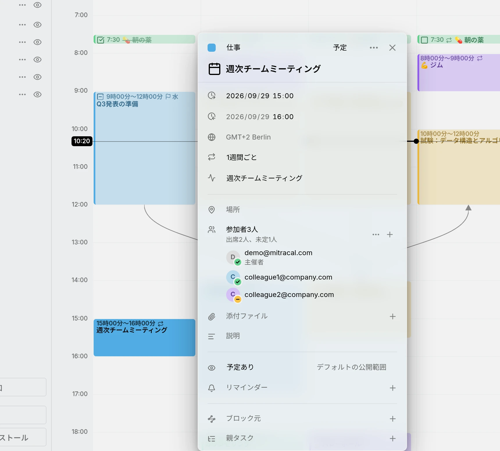

Mitra 0.9 vẫn đang được lên kế hoạch. Phiên bản này ghép những phần việc lớn hơn lại với nhau và cho thấy việc gì có thể làm tiếp theo, để thanh bên đi theo cách bạn suy nghĩ, và viết ngày tháng theo cách bạn đọc.

## Công việc con tốt hơn
Các công việc con của một mục dùng chung một làn trong chế độ xem tháng và năm, nên một dự án hiện ra như một đường, với các công việc con ngắn được gộp vào. Bảng lồng các công việc con dưới công việc cha, và chế độ xem năm có thể ẩn chúng. Tiến độ của một công việc tính từng công việc con theo kích thước của nó, nên một việc dài có trọng số lớn hơn một việc nhanh, và một sự kiện cho thấy tiến độ của các công việc bên dưới nó. Một công việc con không có hạn riêng sẽ lấy hạn của công việc cha.

## Nhóm lịch tùy chỉnh
Nhóm các lịch trên thanh bên theo cách của riêng bạn, bên cạnh cách nhóm theo tài khoản, và ẩn hoặc hiện cả một nhóm cùng lúc.

## Trình dựng vùng nâng cao
Chọn nhiều hơn một ngôn ngữ và khu vực: loại lịch dùng để viết ngày tháng, chữ số, ngày đầu tuần và đồng hồ. Một lịch thứ hai, như lịch Ba Tư, có thể hiện bên cạnh ngày tháng của bạn, và bạn có thể tự đặt múi giờ hiện tại.

## Công việc có thể làm ngay
Kế hoạch liệt kê trong một phần riêng các công việc còn mở mà không công việc mở nào khác chặn, để thấy rõ bạn có thể làm gì ngay bây giờ.

## Cảnh báo với công việc bị chặn
Hoàn thành một công việc mà một công việc mở khác vẫn còn chặn sẽ hỏi trước, để việc làm xong không theo thứ tự là một lựa chọn chứ không phải một sự cố.

## Tích hợp TickTick
Kết nối tài khoản TickTick của bạn, và các danh sách của nó vào Mitra thành các lịch công việc, được đồng bộ hai chiều.

## Thông báo ở nơi bạn dùng
Lời nhắc đến với các công cụ bạn đang dùng, như ntfy, Apprise hoặc webhook của riêng bạn.

## Thêm ngôn ngữ
Mitra giờ đã nói tiếng Nhật, tiếng Hàn và tiếng Việt, mỗi ngôn ngữ đều được dịch đầy đủ, kể cả tài liệu và trang web. Tiếng Nhật và tiếng Hàn được hiển thị bằng phông chữ dành riêng cho chúng.

<picture>
	<source media="(prefers-color-scheme: dark)" srcset="japanese-week-dark.webp">
	
</picture>

## Người đóng góp
- [@a11delavar](https://github.com/a11delavar)
- [@Mugwort150](https://github.com/Mugwort150)
